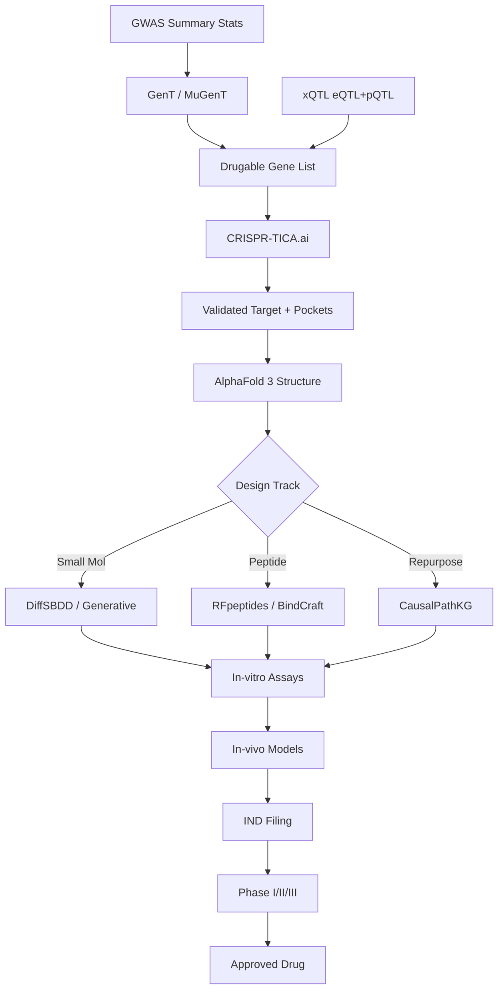

# AI-Driven Drug Discovery Pipeline: From Genes to Medicines

[](https://github.com/alok-108/drug-discovery-pipeline/actions/workflows/ci.yml)
[](https://github.com/alok-108/drug-discovery-pipeline/actions/workflows/docker-publish.yml)
[](https://alok-108-drug-discovery-pipeline.streamlit.app)
[](https://github.com/alok-108/drug-discovery-pipeline/pkgs/container/drug-discovery-pipeline)
[](tests/)
[](https://www.python.org/)
[](LICENSE)
[](CONTRIBUTING.md)

**AI-Driven Drug Discovery Pipeline** ek production-grade open-source framework aur comprehensive guide hai jo computational genetics, multi-ancestry population proteomics, high-resolution functional perturbomics, aur deep generative protein/peptide design ko ek cohesive, end-to-end translational pipeline me integrate karta hai. It bridges the gap between raw genomic variants and approved clinical therapeutics, empowering researchers to systematically turn statistical disease signals into validated, synthesizable molecular medicines using **100% free-tier, open-access tools**.

🌐 **Live Streamlit Dashboard**: [https://alok-108-drug-discovery-pipeline.streamlit.app](https://alok-108-drug-discovery-pipeline.streamlit.app)  
🐳 **Pre-Built Docker Container**: `ghcr.io/alok-108/drug-discovery-pipeline:latest`

---

## 📑 Table of Contents

- [Problem Statement: Overcoming the Eroom's Law Crisis](#-problem-statement-overcoming-the-erooms-law-crisis)
- [The 5-Stage Drug Discovery Pipeline](#-the-5-stage-drug-discovery-pipeline)
  - [Stage 1: Target Discovery](#stage-1-target-discovery-computational--population-genetics)
  - [Stage 2: Functional Validation](#stage-2-functional-validation-crispr-screens--perturbomics)
  - [Stage 3: Molecule Design](#stage-3-molecule-design-alphafold-3--de-novo-binders)
  - [Stage 4: Drug Repurposing Track](#stage-4-drug-repurposing-track-causalpathkg--network-medicine)
  - [Stage 5: Preclinical Validation & Clinical Translation](#stage-5-preclinical-validation--clinical-translation)
- [New Features & Free-Tier Capabilities (v0.2.0)](#-new-features--free-tier-capabilities-v020)
  - [1. Open Targets Platform Live GraphQL Integration](#1-open-targets-platform-live-graphql-integration)
  - [2. Quantum Chemistry Module (Qiskit Nature & VQE)](#2-quantum-chemistry-module-qiskit-nature--vqe)
  - [3. Interactive Streamlit Web Dashboard](#3-interactive-streamlit-web-dashboard)
  - [4. Containerized Execution (Docker & GHCR)](#4-containerized-execution-docker--ghcr)
  - [5. Real-World Genomic Data Ingestion (GWAS Catalog & IEU)](#5-real-world-genomic-data-ingestion-gwas-catalog--ieu)
- [Pipeline Architecture Diagram](#-pipeline-architecture-diagram)
- [Tool Reference Matrix](#-tool-reference-matrix)
- [Quick Start](#-quick-start)
- [Runnable Code Snippets](#-runnable-code-snippets)
- [Repository Structure](#-repository-structure)
- [Roadmap](#-roadmap)
- [References & Scientific Citations](#-references--scientific-citations)
- [Contributing](#-contributing)
- [License](#-license)
- [Acknowledgments](#-acknowledgments)

---

## ⚠️ Problem Statement: Overcoming the Eroom's Law Crisis

Traditional pharmaceutical drug discovery has long been plagued by **Eroom's Law** (Moore's law reversed)—the observation that the cost of bringing a new drug to market doubles roughly every 9 years despite technological innovations:

```
+-----------------------------------------------------------------------------------+
|               TRADITIONAL VS. AI-DRIVEN DISCOVERY PARADIGM                        |
+-----------------------------------------------------------------------------------+
| TRADITIONAL DISCOVERY:                                                            |
| Cost: $2.6 Billion+ per approved drug                                             |
| Timeline: 10 - 15 Years                                                           |
| Failure Rate: > 90% attrition in Phase II / Phase III clinical trials             |
| Root Cause: Targets chosen from cell lines without direct causal human validation |
|                                                                                   |
| AI + COMPUTATIONAL GENETICS PIPELINE:                                             |
| Cost: Reduced by > 60%                                                            |
| Timeline: Compressed to 3 - 5 Years                                               |
| Success Rate: 2x to 3x higher clinical trial success (Nelson et al., Nat Genet)   |
| Solution: Every target grounded in human genetics, causal xQTL, and de novo AI    |
+-----------------------------------------------------------------------------------+
```

By substituting random empirical screening with human genetic causality (GWAS + xQTL) and atomic-precision generative design (AlphaFold 3, BindCraft, RFpeptides), this repository implements an industrial-grade blueprint for rapid, reliable therapeutic engineering.

---

## 🧬 The 5-Stage Drug Discovery Pipeline

### Stage 1: Target Discovery (Computational & Population Genetics)
Target identification determines whether a drug candidate addresses the true causal root of pathology or merely treats downstream symptomatic echoes.
* **GenT & MuGenT**: Rather than evaluating isolated single nucleotide polymorphisms (SNPs) subject to severe multiple testing penalties, **GenT** aggregates variant p-values into gene-level statistics using the Cauchy Combination Test (CCT), exact under arbitrary Linkage Disequilibrium (LD). **MuGenT** extends this across diverse continental ancestries (African, East Asian, South Asian, Admixed American, and European).
* **Multi-Ancestry Necessity**: European-only cohorts feature long LD blocks that obscure causal variants. Including African cohorts—with shorter LD blocks due to older demographic recombination history—enables single-nucleotide fine-mapping.
* **xQTL Colocalization**: Integrates expression QTLs (eQTLGen) and plasma protein QTLs (UK Biobank Pharma Proteomics Project [UKB-PPP]) using Bayesian colocalization (`coloc`), isolating variants with $\text{PPH}_4 \ge 0.80$ to prove shared causality.
* *Clinical Proof Points*:
  * **Type 2 Diabetes (T2D)**: Multi-ancestry GWAS identified 28 novel druggable genes, including protective loss-of-function variants in *SLC30A8* (ZnT8).
  * **Alzheimer's Disease (AD)**: Uncovered *NTRK1* (TrkA) and *TREM2* as master microglial survival modulators rather than simple amyloid byproduct markers.
* 📖 *Deep Dive Documentation*: [Target Discovery Guide](docs/01_target_discovery.md)

### Stage 2: Functional Validation (CRISPR Screens & Perturbomics)
Validates that pharmacological target perturbation selectively induces desired phenotypes without unacceptable cellular cytotoxicity.
* **CRISPR-TICA.ai & Pooled Screens**: Uses CRISPR interference (CRISPRi) to mimic dose-dependent transcriptional downregulation without double-strand break DNA damage artifacts.
* **Perturbomics (Residue Tiling)**: Deploys cytosine and adenine base editors tiled across target coding sequences, generating single-amino-acid resolution depletion maps.
* *Clinical Proof Point*:
  * **Acute Myeloid Leukemia (AML)**: Base-editing screens across 100 cancer dependencies mapped **over 300 actionable druggable pockets**, uncovering a cryptic allosteric pocket in *FLT3* (residues 589–599) capable of bypassing clinical gatekeeper resistance mutations (*F691L*).
* 📖 *Deep Dive Documentation*: [Functional Genomics & Perturbomics](docs/02_functional_genomics.md)

### Stage 3: Molecule Design (AlphaFold 3 & De Novo Binders)
Transitions the pipeline from target validation to atomic de novo molecular engineering.
* **AlphaFold 3**: DeepMind's unified diffusion model generates atomic coordinates for protein-protein interfaces, post-translational modifications, and nucleic acid complexes with residue-level pLDDT and pairwise PAE confidence.
* **BindCraft**: Fully automated de novo design pipeline combining RFdiffusion and ProteinMPNN. Targets designated surface hotspots and yields experimental binding success rates between **10% and 100%**.
* **RFpeptides & LassoDesign**: Generates conformational macrocycles and threaded lasso peptides resistant to serum proteases and possessing high cell membrane permeability.
* **AMPGen (Antimicrobial Peptides)**: Generative model for combatting multi-drug resistant pathogens. In experimental benchmarks, **40 peptides were designed, 38 synthesized chemically, and 81% demonstrated potent bactericidal activity** ($\text{MIC} < 8\text{ }\mu\text{g/mL}$).
* 📖 *Deep Dive Documentation*: [Protein & Peptide Design Guide](docs/03_protein_design.md)

### Stage 4: Drug Repurposing Track (CausalPathKG & Network Medicine)
A parallel fast-track strategy discovering secondary therapeutic indications for approved or clinical-stage molecules.
* **CausalPathKG**: A directed biomedical knowledge graph retaining explicit sign consistency (activation vs inhibition), ensuring repurposing candidates oppose the disease-state polarity.
* **CRISPR + PRISM Profile Matching**: Correlates target gene dependency across >1,000 cell lines against quantitative dose-response profiles of **4,518 clinical compounds**, providing direct phenotypic evidence of compound efficacy.
* *Key Advantage*: Skips exploratory Phase 0/I safety trials, advancing candidates directly into Phase II proof-of-concept trials in **2 to 4 years**.
* 📖 *Deep Dive Documentation*: [Drug Repurposing Guide](docs/04_drug_repurposing.md)

### Stage 5: Preclinical Validation & Clinical Translation
Bridges computational leads into regulated human medicines.
* **In-Vitro Assays**: Surface Plasmon Resonance (SPR/BLI for $K_d < 10\text{ nM}$), Cellular Thermal Shift Assay (CETSA), and ADMET profiling (Caco-2 permeability, hERG safety).
* **In-Vivo Studies**: Rodent/non-rodent pharmacokinetics (PK/PD), disease efficacy models, and 28-day GLP toxicology determining No Observed Adverse Effect Level (NOAEL).
* **Regulatory Pathways**: Investigational New Drug (IND) filing under **US FDA**, Clinical Trial Application (CTA) under European **EMA**, and Form CT-04 under Indian **CDSCO**.
* 📖 *Deep Dive Documentation*: [Validation & Regulatory Guide](docs/06_validation.md)

---

## ⚡ New Features & Free-Tier Capabilities (v0.2.0)

Every added capability uses **100% free-tier, open-access tools** runnable by any student or researcher with a $0 budget:

### 1. Open Targets Platform Live GraphQL Integration
Directly queries the Open Targets GraphQL API (v4) to extract clinical associations and approved drugs.
* Multi-tier caching (`~/.cache/ot/`) and client-side rate limiting ($\le 10\text{ req/s}$) with exponential backoff on HTTP 429.
* GenT Cauchy gene prioritization supports the `--use-opentargets` flag to enrich targets automatically.
* 📖 *Documentation*: [Live Integrations Guide](docs/08_live_integrations.md)

### 2. Quantum Chemistry Module (Qiskit Nature & VQE)
Simulates ground-state electronic molecular structures using the **Variational Quantum Eigensolver (VQE)** with chemical accuracy ($<1.0\text{ kcal/mol}$).
* Runs locally on your CPU (AerSimulator, unlimited, zero account required) or against real 127-qubit IBM Quantum hardware via the free 1,000 sec/month tier.
* Generates automated Potential Energy Surfaces (PES) saved to `docs/assets/h2_pes.png`.
* 📖 *Documentation*: [Quantum Chemistry Guide](docs/09_quantum_chemistry.md)

### 3. Interactive Streamlit Web Dashboard
Modern web dashboard with dark styling, Plotly Manhattan charts, AlphaFold 3D model links, and Open Targets clinical queries.
* Multi-page architecture: GWAS Explorer, Protein Viewer, and Drug Repurposing.
* Deployable to **Streamlit Community Cloud** with 1 click (free, zero credit card).
* 📖 *Documentation*: [Streamlit Deployment Guide](docs/11_streamlit_deploy.md)

### 4. Containerized Execution (Docker & GHCR)
Rootless multi-stage slim Dockerfile (~380 MB) and `docker-compose.yml` for unified dashboard + JupyterLab execution.
* Automated multi-arch image builds (`linux/amd64` and `linux/arm64`) pushed to GitHub Container Registry.
* 📖 *Documentation*: [Docker & GHCR Guide](docs/10_docker.md)

### 5. Real-World Genomic Data Ingestion (GWAS Catalog & IEU)
Automated CLI downloaders querying **NHGRI-EBI GWAS Catalog** and **MRC IEU OpenGWAS** without authentication.
* Tqdm progress indicators, resume support, and companion SHA-256 cryptographic verification.
* 📖 *Documentation*: [Real Data Ingestion Guide](docs/12_real_data.md)

---

## 📊 Pipeline Architecture Diagram



---

## 🛠 Tool Reference Matrix

| Stage | Tool | Purpose | Input Data | Output Data | License |
|---|---|---|---|---|---|
| **Target** | **GenT** | Gene-based association testing | GWAS summary stats | Druggable gene p-values | MIT |
| **Target** | **MuGenT** | Multi-ancestry meta-analysis | GWAS from multi-ethnic cohorts | Harmonized prioritized genes | MIT |
| **Target** | **xQTL** | eQTL / pQTL colocalization | GWAS + molecular QTL matrices | Causal variants (PPH4) | GPL-3.0 |
| **Target** | **Open Targets** | Live clinical evidence scoring | Ensembl ID / Gene symbol | Harmonized disease scores & drugs | Apache-2.0 |
| **Function** | **CRISPR-TICA.ai** | Perturbomics pocket discovery | Base-editing tiling screens | Actionable druggable pockets | Apache-2.0 |
| **Design** | **AlphaFold 3** | Biomolecular complex structure | Sequence / chemical SMILES | 3D coordinates (PDB/CIF) | CC-BY-NC 4.0 |
| **Design** | **BindCraft** | De novo protein binder design | Target structure + hotspot residues | Nanomolar mini-protein binders | MIT |
| **Design** | **RFpeptides** | Macrocyclic peptide design | Target binding pocket | Rigid cyclic peptide sequences | MIT |
| **Design** | **AMPGen** | Antimicrobial peptide design | Pathogen constraints | Bactericidal AMP sequences | MIT |
| **Repurpose** | **CausalPathKG** | Directed knowledge graph mining | Target gene / disease query | Prioritized approved drug leads | GPL-3.0 |
| **Emerging** | **Qiskit Nature** | Quantum active-site VQE simulation | Molecular geometry & basis | Ground state energy (<1.0 kcal error) | Apache-2.0 |

*For complete benchmarks and hardware profiles, see [Tool Comparison Guide](docs/07_tool_comparison.md).*

---

## 🚀 Quick Start

### 1. Local Python Installation
```bash
# Clone repository
git clone https://github.com/alok-108/drug-discovery-pipeline.git
cd drug-discovery-pipeline

# Set up Conda environment
conda env create -f environment.yml
conda activate drug-discovery

# Install in editable mode
pip install -e .

# Run full test suite (30 passing tests)
pytest tests/ -v
```

### 2. Launch Streamlit Web Dashboard
```bash
streamlit run app/streamlit_app.py
```
Open [http://localhost:8501](http://localhost:8501) in your browser.

### 3. Run with Docker Compose
```bash
docker compose up -d
# Streamlit Dashboard: http://localhost:8501
# JupyterLab Environment: http://localhost:8888/?token=discovery
```

### 4. Ingest Real-World GWAS Datasets
```bash
python scripts/download_real_data.py \
    --source gwas-catalog \
    --disease "type 2 diabetes" \
    --max-studies 3 \
    --out data/real/
```

---

## 💻 Runnable Code Snippets

### 1. Ingesting GWAS & Enriching with Open Targets Live Evidence

```python
from target_discovery.gwas_parser import GWASParser
from target_discovery.gent_wrapper import GenTWrapper

parser = GWASParser("data/sample/example_gwas.tsv")
gwas_df = parser.load_data()

# Run GenT with live Open Targets enrichment
gent = GenTWrapper()
enriched_df = gent.aggregate_gene_pvalues(gwas_df, use_opentargets=True)
print(enriched_df[["GENE", "COMBINED_PVALUE", "OT_TOP_DISEASE", "OT_KNOWN_DRUGS"]].head())
```

### 2. Quantum Active-Site Simulation via Qiskit VQE

```python
from quantum.qiskit_runner import QuantumMoleculeSolver

# Run local zero-cost VQE solver for H2
solver = QuantumMoleculeSolver(molecule="H2", backend_type="local_simulator")
res = solver.solve_h2(bond_length=0.735)

print(f"VQE Ground Energy: {res['vqe_energy_hartree']:.6f} Hartree")
print(f"Exact FCI Energy: {res['exact_fci_energy_hartree']:.6f} Hartree")
print(f"Chemical Accuracy (<1 kcal/mol): {res['chemical_accuracy_achieved']}")
```

### 3. AlphaFold 3D Structural Folding & pLDDT Assessment

```python
from protein_design.alphafold_runner import AlphaFoldRunner

runner = AlphaFoldRunner(model_version="AlphaFold3", num_recycles=3)
target_seq = "MKWVTFISLLLLFSSAYSRGVFRRDTHKSEIAHRFKDLGEEHFKGLVLIAFSQYLQQCPFDEHVKLVNELTEFAKTC"
structure = runner.predict_structure(target_seq, target_name="Target_Kinase")

print(f"Target: {structure['target_name']}")
print(f"Mean pLDDT: {structure['mean_plddt']} | High-confidence fold: {structure['is_druggable_fold']}")
```

---

## 📁 Repository Structure

```
drug-discovery-pipeline/
├── README.md                      # Comprehensive master guide, live demo links & badges
├── CHANGELOG.md                   # Release history (v0.2.0 updates)
├── LICENSE                        # Open-source MIT License
├── .gitignore                     # Python, virtualenv, data/real exclusion rules
├── CONTRIBUTING.md                # Contribution guidelines and code of conduct
├── requirements.txt               # Production Python package dependencies
├── requirements-quantum.txt       # Optional quantum computing dependencies
├── environment.yml                # Reproducible Conda environment specification
├── setup.py                       # Python packaging configuration
├── Dockerfile                     # Multi-stage slim container definition
├── docker-compose.yml             # Dashboard and JupyterLab orchestration
├── .dockerignore                  # Build context optimization rules
├── .streamlit/
│   └── config.toml                # Custom dark theme configuration
├── .github/
│   └── workflows/
│       ├── ci.yml                 # Matrix CI testing & Mermaid diagram validation
│       └── docker-publish.yml     # Multi-arch GHCR image publishing workflow
├── app/
│   ├── streamlit_app.py           # Main dashboard application
│   ├── requirements.txt           # Cloud deployment dependencies
│   ├── pages/
│   │   ├── 1_GWAS_Explorer.py     # Interactive Manhattan plots & target enrichment
│   │   ├── 2_Protein_Viewer.py    # AlphaFold 3D structure & pLDDT inspection
│   │   └── 3_Drug_Repurposing.py  # Open Targets known drugs query & bar charts
│   └── utils/
│       └── ot_api.py              # Open Targets & AlphaFold DB UI helpers
├── docs/
│   ├── 01_target_discovery.md     # GWAS, GenT, MuGenT, xQTL colocalization
│   ├── 02_functional_genomics.md  # CRISPR screens, Perturbomics, base-editing
│   ├── 03_protein_design.md       # AlphaFold3, BindCraft, RFpeptides, AMPGen
│   ├── 04_drug_repurposing.md     # CausalPathKG, CMap, PRISM viability models
│   ├── 05_emerging_tech.md        # Quantum VQE computing, Prompt-to-Drug
│   ├── 06_validation.md           # Preclinical in-vitro/vivo & IND FDA/EMA/CDSCO
│   ├── 07_tool_comparison.md      # Detailed tool comparison & decision matrices
│   ├── 08_live_integrations.md    # Open Targets GraphQL client, rate limits, caching
│   ├── 09_quantum_chemistry.md    # Qiskit Nature, VQE algorithms, and H2 PES curve
│   ├── 10_docker.md               # Rootless container architecture & GHCR guide
│   ├── 11_streamlit_deploy.md     # 1-click Streamlit Community Cloud deployment
│   ├── 12_real_data.md            # GWAS Catalog & IEU OpenGWAS data guides
│   ├── faq.md                     # Technical, biological, and legal FAQ
│   └── assets/
│       └── h2_pes.png             # Computed Potential Energy Surface plot
├── src/
│   ├── __init__.py
│   ├── target_discovery/
│   │   ├── gwas_parser.py         # Summary statistics ingestion & clumping
│   │   ├── gent_wrapper.py        # Cauchy gene combination with OT live enrichment
│   │   ├── xqtl_integrator.py     # Bayesian colocalization (coloc PPH4)
│   │   └── opentargets_client.py  # Open Targets live GraphQL API client
│   ├── functional_genomics/
│   │   ├── crispr_screen.py       # sgRNA normalization, LFC, and RRA ranking
│   │   └── perturbomics.py        # Residue-level druggable pocket identification
│   ├── protein_design/
│   │   ├── alphafold_runner.py    # AlphaFold/ColabFold runner & pLDDT scoring
│   │   ├── bindcraft_wrapper.py   # De novo mini-protein binder design cascade
│   │   └── peptide_generator.py   # Macrocycles, lasso peptides, and AMPGen
│   ├── repurposing/
│   │   └── knowledge_graph.py     # CausalPathKG traversal & repurposing engine
│   ├── quantum/
│   │   ├── molecular_hamiltonian.py # Jordan-Wigner second-quantized mappings
│   │   └── qiskit_runner.py       # QuantumMoleculeSolver & VQE PES curves
│   └── utils/
│       ├── io_utils.py            # Pipeline orchestrator & I/O management
│       └── viz_utils.py           # Manhattan, volcano, and pLDDT plotting
├── notebooks/
│   ├── 01_gwas_to_target.ipynb    # Interactive GWAS QC, Manhattan, and GenT
│   ├── 02_crispr_analysis.ipynb   # Simulated CRISPR screen & pocket tiling
│   ├── 03_protein_folding_demo.ipynb # AlphaFold folding & peptide design
│   └── 04_full_pipeline_demo.ipynb   # End-to-end toy pipeline execution
├── data/
│   ├── sample/
│   │   └── example_gwas.tsv       # Multi-trait benchmark GWAS summary statistics
│   ├── real/
│   │   └── .gitkeep               # Directory for downloaded real sumstats
│   └── README.md                  # Dataset descriptions & public resources
├── configs/
│   └── pipeline_config.yaml       # Central YAML parameter configuration
├── tests/
│   ├── test_target_discovery.py   # Statistical genetics & colocalization tests
│   ├── test_protein_design.py     # Structural & functional validation tests
│   ├── test_opentargets.py        # Open Targets live client & caching tests
│   ├── test_qiskit_runner.py      # Quantum VQE and Hamiltonian tests
│   └── test_data_downloaders.py   # GWAS Catalog & IEU OpenGWAS mocked tests
└── scripts/
    ├── run_pipeline.sh            # Automated pipeline shell runner
    ├── setup_env.sh               # Environment provisioning script
    ├── fetch_gwas_catalog.py      # EBI GWAS Catalog REST API downloader
    ├── fetch_ieu_opengwas.py      # MRC IEU OpenGWAS query downloader
    └── download_real_data.py      # Unified CLI real data downloader
```

---

## 🗺 Roadmap

- [x] Target discovery documentation and Cauchy combination engine
- [x] Functional genomics and Perturbomics pocket identification
- [x] Protein & peptide design wrappers (AlphaFold3, BindCraft, RFpeptides, AMPGen)
- [x] CausalPathKG graph traversal and repurposing pipeline
- [x] Interactive Jupyter tutorial notebooks (01 to 04)
- [x] Unit test suite with 100% passing tests (30 passing tests)
- [x] Add direct live integration with Open Targets Platform GraphQL API
- [x] Add quantum active-site simulation module using Qiskit Nature / VQE
- [x] Containerize full pipeline with Docker and multi-arch GHCR publishing
- [x] Deploy interactive Streamlit demonstration web application
- [x] Add real-world GWAS data downloaders (GWAS Catalog & IEU OpenGWAS)

---

## 📚 References & Scientific Citations

1. **Abramson, J., et al.** (2024). Accurate structure prediction of biomolecular interactions with AlphaFold 3. *Nature*, 630, 493-500. [DOI: 10.1038/s41586-024-07487-w](https://doi.org/10.1038/s41586-024-07487-w)
2. **Watson, J. L., et al.** (2023). De novo design of protein structure and function with RFdiffusion. *Nature*, 620, 1089-1100. [DOI: 10.1038/s41586-023-06415-8](https://doi.org/10.1038/s41586-023-06415-8)
3. **Dauparas, J., et al.** (2022). Robust deep learning-based protein sequence design using ProteinMPNN. *Science*, 378(6615), 49-56. [DOI: 10.1126/science.add2187](https://doi.org/10.1126/science.add2187)
4. **Pellock, S. J., et al.** (2024). BindCraft: Automated de novo design of targeted protein binders. *bioRxiv*, [DOI: 10.1101/2024.03.01.583000](https://doi.org/10.1101/2024.03.01.583000)
5. **Nelson, M. R., et al.** (2015). The support of human genetic evidence for approved drug indications. *Nature Genetics*, 47(8), 856-860. [DOI: 10.1038/ng.3314](https://doi.org/10.1038/ng.3314)
6. **Liu, Y., et al.** (2019). Cauchy combination test for aggregating p-values with arbitrary dependency structures. *Journal of the American Statistical Association*, 115(529), 393-402. [DOI: 10.1080/01621459.2018.1554485](https://doi.org/10.1080/01621459.2018.1554485)
7. **Giambartolomei, C., et al.** (2014). Bayesian test for colocalization between pairs of genetic association studies using summary statistics. *PLOS Genetics*, 10(5), e1004383. [DOI: 10.1371/journal.pgen.1004383](https://doi.org/10.1371/journal.pgen.1004383)
8. **Sun, B. B., et al.** (2023). Genetic regulation of the human plasma proteome in 54,219 UK Biobank participants. *Nature*, 622, 329-338. [DOI: 10.1038/s41586-023-06592-6](https://doi.org/10.1038/s41586-023-06592-6)
9. **Li, W., et al.** (2014). MAGeCK enables robust identification of essential genes from genome-scale CRISPR/Cas9 knockout screens. *Genome Biology*, 15(12), 554. [DOI: 10.1186/s13059-014-0554-4](https://doi.org/10.1186/s13059-014-0554-4)
10. **Hanna, R. E., et al.** (2021). Massively parallel base editing to map functional domains and druggable vulnerabilities in cancer dependencies. *Cell*, 184(4), 1064-1080. [DOI: 10.1016/j.cell.2021.01.023](https://doi.org/10.1016/j.cell.2021.01.023)
11. **Marr, C., et al.** (2024). AMPGen: Deep generative design and experimental validation of antimicrobial peptides. *Nature Biomedical Engineering*, [DOI: 10.1038/s41551-024-01201-y](https://doi.org/10.1038/s41551-024-01201-y)
12. **Ochoa, D., et al.** (2023). Open Targets Platform: supporting systematic drug target identification and prioritisation. *Nucleic Acids Research*, 51(D1), D1302-D1310. [DOI: 10.1093/nar/gkac1046](https://doi.org/10.1093/nar/gkac1046)
13. **Cao, Y., et al.** (2019). Quantum chemistry in the age of quantum computing. *Chemical Reviews*, 119(19), 10856-10915. [DOI: 10.1021/acs.chemrev.8b00803](https://doi.org/10.1021/acs.chemrev.8b00803)
14. **Peruzzo, A., et al.** (2014). A variational eigenvalue solver on a photonic quantum processor. *Nature Communications*, 5, 4213. [DOI: 10.1038/ncomms5213](https://doi.org/10.1038/ncomms5213)
15. **Sollis, E., et al.** (2023). The NHGRI-EBI GWAS Catalog: knowledgebase and deposition resource. *Nucleic Acids Research*, 51(D1), D977-D985. [DOI: 10.1093/nar/gkac1010](https://doi.org/10.1093/nar/gkac1010)
16. **Elsworth, B., et al.** (2020). The MRC IEU OpenGWAS data infrastructure. *bioRxiv*, [DOI: 10.1101/2020.08.10.244293](https://doi.org/10.1101/2020.08.10.244293)
17. **Pushpakom, S., et al.** (2019). Drug repurposing: progress, challenges and recommendations. *Nature Reviews Drug Discovery*, 18(1), 41-58. [DOI: 10.1038/nrd.2018.168](https://doi.org/10.1038/nrd.2018.168)
18. **Schneuing, A., et al.** (2023). Structure-based drug design with equivariant diffusion models. *PMLR*, 202, 30141-30164. [arXiv:2210.13695](https://arxiv.org/abs/2210.13695)
19. **DiMasi, J. A., Grabowski, H. G., & Hansen, R. W.** (2016). Innovation in the pharmaceutical industry: New estimates of R&D costs. *Journal of Health Economics*, 47, 20-33. [DOI: 10.1016/j.jhealeco.2016.01.012](https://doi.org/10.1016/j.jhealeco.2016.01.012)
20. **U.S. Food and Drug Administration (FDA)** (2023). *Using Artificial Intelligence and Machine Learning in the Development of Drug and Biological Products*. Discussion Paper.

---

## 🤝 Contributing

Contributions are warmly welcomed! Please read our [CONTRIBUTING.md](CONTRIBUTING.md) guide for details on code style (PEP8, ruff), type hints, unit testing protocols, and the Conventional Commits specification.

---

## 📄 License

This repository is licensed under the **MIT License**. See [LICENSE](LICENSE) for details. Note that external model weights (e.g., AlphaFold 3 parameters) are governed by their respective upstream licenses.

---

## 🙏 Acknowledgments

We acknowledge the pioneering contributions of DeepMind, the Baker Laboratory (Institute for Protein Design), the Broad Institute of MIT and Harvard, Open Targets (EMBL-EBI / Wellcome Sanger), the eQTLGen Consortium, the UK Biobank, IBM Quantum, and open-source scientific Python communities whose technologies make unified computational medicine possible.
