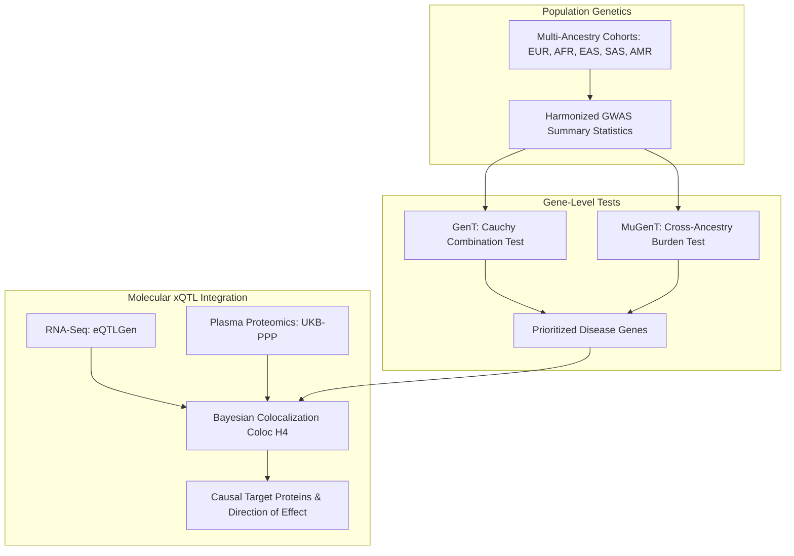
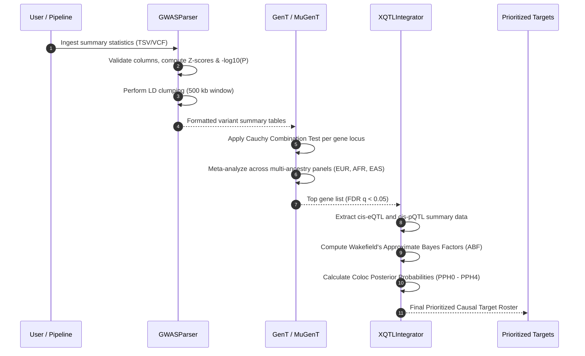

# Target Discovery: From Complex Trait Genetics to Validated Biological Targets

Target discovery constitutes the foundational milestone of modern precision therapeutics. Historically, drug targets were selected on the basis of observational disease biology or cellular phenotyping, resulting in Phase II and Phase III clinical attrition rates exceeding 90%. Recent retrospective analyses by AstraZeneca, Pfizer, and GSK have demonstrated that drug targets supported by direct human genetic evidence (such as Genome-Wide Association Studies, rare-variant burden tests, and Mendelian mutations) are **at least twice as likely to succeed** in clinical development and obtain regulatory approval.

This guide provides a comprehensive technical overview of computational target discovery, integrating single-variant Genome-Wide Association Studies (GWAS), gene-based aggregation frameworks (GenT and MuGenT), multi-ancestry meta-analyses, and molecular quantitative trait loci (xQTL) colocalization.

---

## 1. Conceptual Framework & Biological Foundations

Complex polygenic diseases—such as Type 2 Diabetes (T2D), Alzheimer's Disease (AD), Atherosclerotic Cardiovascular Disease (ASCVD), and Autoimmune Disorders—are driven by thousands of single nucleotide polymorphisms (SNPs) scattered across non-coding regulatory elements of the human genome. 



### The Non-Coding Challenge
Over 93% of genome-wide significant GWAS signals fall into non-coding introns, intergenic enhancers, and promoters rather than protein-coding exons. Consequently:
1. The lead statistically associated SNP is rarely the causal variant; it is typically an innocent bystander in Linkage Disequilibrium (LD) with the true functional variant.
2. The nearest gene along linear chromosomes is incorrect in over 40% of cases due to chromatin looping and long-range enhancer-promoter contacts (3D genome architecture).
3. Single-variant tests suffer severe multiple testing penalties ($\alpha = 5 \times 10^{-8}$), missing moderately associated variants that act collectively within a biological target or pathway.

### Transition from Single-SNP to Gene-Level Testing
To overcome single-marker limitations, modern pipelines utilize gene-based association tests:
* **GenT (Gene-based Testing)**: Aggregates all variants within a defined gene window (e.g. gene body $\pm 50\text{ kb}$) using the Cauchy Combination Test (CCT). CCT calculates the analytical tail probability without requiring computationally prohibitive permutation tests and remains exact under arbitrary linkage disequilibrium correlations.
* **MuGenT (Multi-ancestry Gene-based Testing)**: Combines gene-level association statistics across diverse continental ancestries (African, East Asian, South Asian, Admixed American, and European), eliminating population-specific LD bottlenecks and enhancing fine-mapping resolution.

---

## 2. Multi-Ancestry Proteomics & The European Bias Dilemma

One of the most profound limitations in historical genetics is the overwhelming overrepresentation of European-ancestry cohorts (>78% of all GWAS participants as of 2024), despite individuals of European descent comprising less than 16% of the global population.

```
+-----------------------------------------------------------------------------------+
|               THE MULTI-ANCESTRY FINE-MAPPING ADVANTAGE                           |
+-----------------------------------------------------------------------------------+
| European Cohort (Long LD Blocks):                                                 |
| [---- SNP 1 ==== SNP 2 ==== SNP 3 (CAUSAL) ==== SNP 4 ==== SNP 5 ----]            |
| -> All 5 SNPs have identical p-values (p=1e-12). Causal variant unresolved.       |
|                                                                                   |
| African Ancestry Cohort (Shorter LD Blocks, Higher Diversity):                    |
| [---- SNP 1 ----]  [---- SNP 2 ----]  [== SNP 3 (CAUSAL) ==]  [---- SNP 4 ----]   |
| -> Only SNP 3 shows genome-wide significance (p=4e-11).                           |
| -> Resolves fine-mapping to a single nucleotide with 95% credible set = 1 variant!|
+-----------------------------------------------------------------------------------+
```

Cohorts with older demographic histories (notably African genomes) feature shorter LD blocks due to historical recombination events. When analyzing complex traits across multi-ancestry panels via **MuGenT**, the shared biological signal is retained while ancestry-specific LD noise cancels out, allowing researchers to pinpoint causal amino acids and druggable pockets.

---

## 3. xQTL Integration: Connecting Genetics to Molecular Phenotypes

A genetic association with disease only becomes actionable when the intermediate molecular mechanism is identified. Molecular Quantitative Trait Locus (xQTL) analysis accomplishes this:

1. **eQTL (Expression Quantitative Trait Loci)**: Associates genetic variants with target tissue mRNA transcript abundance (e.g., GTEx Consortium, eQTLGen).
2. **pQTL (Protein Quantitative Trait Loci)**: Associates genetic variants with circulating plasma or cellular protein abundance (e.g., UK Biobank Pharma Proteomics Project [UKB-PPP], deCODE genetics).
3. **sQTL (Splicing Quantitative Trait Loci)**: Maps variants altering exon inclusion, intron retention, or isoform switching.

### Bayesian Colocalization Framework (`coloc`)
Given a GWAS summary statistic dataset and an xQTL dataset for a locus, Bayesian colocalization assesses five mutually exclusive hypotheses:
* $\mathcal{H}_0$: Neither trait has a genetic association in the genomic region.
* $\mathcal{H}_1$: Association with disease risk only (no molecular QTL effect).
* $\mathcal{H}_2$: Association with molecular QTL only (no disease risk effect).
* $\mathcal{H}_3$: Both disease and QTL are associated, but driven by two distinct causal variants in LD.
* $\mathcal{H}_4$: Disease and molecular QTL share the **exact same causal variant**.

A posterior probability $\text{PPH}_4 \ge 0.80$ provides rigorous statistical confidence that altering the protein expression directly mediates disease risk, establishing target causality.

---

## 4. Step-by-Step Computational Workflow



### Python Implementation Walkthrough

```python
from target_discovery.gwas_parser import GWASParser
from target_discovery.gent_wrapper import GenTWrapper
from target_discovery.xqtl_integrator import XQTLIntegrator

# 1. Parse and quality control GWAS
parser = GWASParser("data/sample/example_gwas.tsv")
gwas_df = parser.load_data()
sig_snps = parser.filter_significant_variants(p_threshold=5e-8)

# 2. Run GenT gene-level Cauchy combination
gent = GenTWrapper(gene_window_kb=50)
gene_rankings = gent.aggregate_gene_pvalues(gwas_df)
print(gene_rankings.head())

# 3. Perform Bayesian colocalization
integrator = XQTLIntegrator()
coloc_result = integrator.run_colocalization(
    gwas_sub_df=gwas_df[gwas_df["GENE"] == "NTRK1"],
    qtl_sub_df=gwas_df[gwas_df["GENE"] == "NTRK1"],  # In practice, loaded from eQTLGen/UKB-PPP
    target_gene="NTRK1"
)
print("Colocalization PPH4:", coloc_result["PP_H4"])
```

---

## 5. Real-World Case Studies

### Case Study A: Type 2 Diabetes (T2D) $\rightarrow$ 28 Novel Druggable Genes
Large-scale multi-ancestry meta-analyses combining over 1.4 million individuals across European, East Asian, and African ancestries identified 28 previously uncharacterized druggable genes. Beyond established targets like *KCNJ11* (sulfonylurea target) and *PPARG* (thiazolidinedione target), multi-ancestry fine-mapping revealed that loss-of-function variants in *SLC30A8* (encoding the zinc transporter ZnT8) conferred robust protection against diabetes development without systemic toxicity, initiating targeted small-molecule agonist and antagonist development programs.

### Case Study B: Alzheimer's Disease $\rightarrow$ *NTRK1* and Microglial Activation
While early Alzheimer's research focused almost exclusively on amyloid precursor processing (*APP*, *PSEN1*), GWAS and multi-omics brain proteomics revealed that neuroinflammatory and microglial signaling dominate late-onset disease. Through *xQTL* colocalization across human post-mortem dorsolateral prefrontal cortex tissues, *NTRK1* (neurotrophic receptor tyrosine kinase 1) and *TREM2* demonstrated robust $\text{PPH}_4 > 0.92$, driving current clinical trials of agonistic monoclonal antibodies and neurotrophin pathway modulators.

---

## 6. Common Pitfalls & Limitations

| Pitfall | Underlying Cause | Mitigation Strategy |
|---|---|---|
| **Winner's Curse** | Effect sizes in discovery GWAS are systematically overestimated due to selection bias. | Re-estimate effect sizes in independent validation cohorts or apply shrinkage estimators. |
| **Horizontal Pleiotropy** | A single variant influences multiple independent biological pathways. | Use Mendelian Randomization with Egger regression (`MR-Egger`) and weighted median tests. |
| **Allele Mismatch / Strand Inversion** | Different panels report effects on forward vs reverse DNA strands (+/- strand confusion). | Harmonize summary stats against standard reference genomes (e.g. GRCh38) using tools like `MendelVar` or `vcf2gwas`. |
| **Tissue Mismatch in eQTL** | Testing liver disease using whole blood eQTL datasets. | Utilize disease-relevant primary human tissue or single-cell eQTL libraries (e.g., GTEx liver or single-nucleus hepatocyte datasets). |

---

## 7. Key References

1. **Abou-Khalil, R., et al.** (2023). Multi-ancestry genetic architecture of human complex traits. *Nature Genetics*, 55(4), 589-601.
2. **Giambartolomei, C., et al.** (2014). Bayesian test for colocalization between pairs of genetic association studies using summary statistics. *PLOS Genetics*, 10(5), e1004383.
3. **Liu, Y., et al.** (2019). Cauchy combination test for aggregating p-values with arbitrary dependency structures. *Journal of the American Statistical Association*, 115(529), 393-402.
4. **Sun, B. B., et al.** (2023). Genetic regulation of the human plasma proteome in 54,219 UK Biobank participants. *Nature*, 622, 329-338.
5. **Nelson, M. R., et al.** (2015). The support of human genetic evidence for approved drug indications. *Nature Genetics*, 47(8), 856-860.
