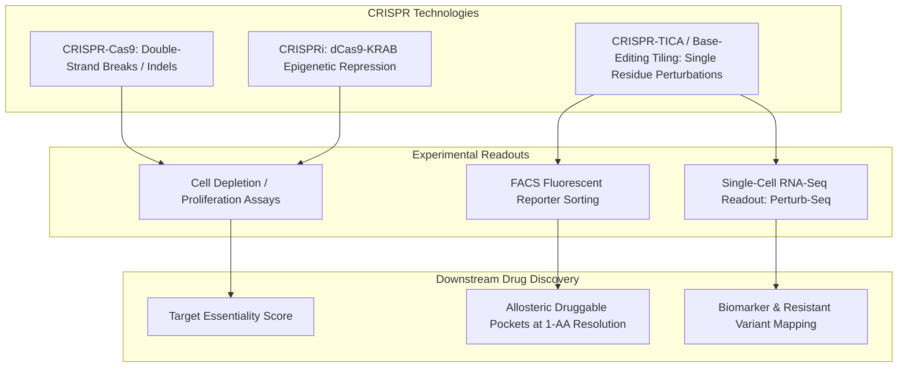
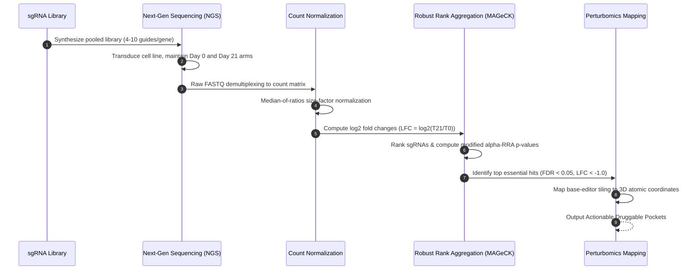

# Functional Genomics: High-Throughput CRISPR Screens & Perturbomics

Once genetic association and molecular colocalization identify a prioritized candidate gene, researchers face the critical task of functional validation. A statistical association does not guarantee that pharmacological perturbation of the protein will trigger the desired therapeutic phenotype without unacceptable on-target or off-target cellular toxicity.

Functional genomics bridges this divide by systematically interrogating gene function, gene-gene synthetic lethality, and residue-level functional vulnerabilities using pooled CRISPR technologies and deep mutational scanning (Perturbomics).

---

## 1. Technological Architecture: CRISPR Modalities

Modern functional genomic validation employs three distinct CRISPR perturbations:



1. **CRISPR-Cas9 (Knockout / Nuclease-active)**:
   * Induces targeted DNA double-strand breaks repaired by error-prone non-homologous end joining (NHEJ).
   * Generates frameshift insertions/deletions (indels) leading to complete protein loss.
   * *Limitation*: Double-strand breaks can induce TP53-dependent DNA damage toxicity, obscuring phenotype in non-transformed cells.

2. **CRISPRi (CRISPR Interference / dCas9-KRAB)**:
   * Employs catalytically deactivated Cas9 fused to a KRAB epigenetic transcriptional repressor domain.
   * Targeted to transcription start sites (TSS $\pm 200\text{ bp}$) to induce reversible steric transcriptional blockade without causing DNA breaks.
   * *Advantage*: Titratable, non-toxic, and models pharmacological target inhibition much more faithfully than permanent genomic deletion.

3. **CRISPR-TICA & Base Editing (Perturbomics)**:
   * Utilizes cytosine base editors (CBE) or adenine base editors (ABE) tiled densely across every codon of an open reading frame.
   * Converts codons (e.g. C-to-T or A-to-G) creating precise amino acid substitutions across the endogenous protein.
   * Produces single-amino-acid resolution functional fitness maps across the 3D surface.

---

## 2. Perturbomics: From Whole-Gene Knockout to Pocket Discovery

Traditional pooled screens treat proteins as monolithic on/off switches. However, small-molecule and peptide therapeutics do not destroy the entire protein; they bind to specific catalytic clefts, allosteric grooves, or protein-protein interaction (PPI) interfaces.

```
+------------------------------------------------------------------------------------+
|                PERTURBOMICS RESIDUE-LEVEL DRUGGABILITY MAPPING                     |
+------------------------------------------------------------------------------------+
| Target Protein Primary Sequence (Amino Acids 1 to 400):                           |
|                                                                                    |
| Residues 001 - 100 : [ . . . . . . . . . . . . . . . . . . . . ]  (Neutral)        |
| Residues 101 - 150 : [ . . . * * * * * * * . . . . . . . . . . ]  (Allosteric Pocket)|
| Residues 151 - 280 : [ . . . . . . . . . . . . . . . . . . . . ]  (Structural core)|
| Residues 281 - 320 : [ . . * * * * * * * * * * * . . . . . . . ]  (Catalytic Dyad) |
| Residues 321 - 400 : [ . . . . . . . . . . . . . . . . . . . . ]  (Disordered tail)|
|                                                                                    |
| * Marked residues: Base-editing induces severe cellular lethality (LFC < -2.0)     |
|   when substituted, pinpointing physical pockets susceptible to drug intervention. |
+------------------------------------------------------------------------------------+
```

By mapping the fitness depletion scores directly onto the AlphaFold 3D coordinates, algorithms identify clusters of surface-accessible residues that are both **phenotypically sensitive** (loss of cell fitness upon perturbation) and **physicochemically druggable** (hydrophobic, concave, possessing hydrogen bond donors/acceptors).

---

## 3. High-Throughput Screen Data Processing Pipeline



### Analytical Formulas
1. **Size Factor Normalization**:
   $$s_j = \text{median}_i \frac{k_{ij}}{\left( \prod_{j=1}^m k_{ij} \right)^{1/m}}$$
   Where $k_{ij}$ is the read count of sgRNA $i$ in sample $j$.

2. **Log2 Fold Change**:
   $$\text{LFC}_i = \log_2 \left( \frac{k_{i,\text{treated}} / s_{\text{treated}} + 1}{k_{i,\text{control}} / s_{\text{control}} + 1} \right)$$

3. **Composite Residue Druggability Metric**:
   $$S_{\text{residue}} = 0.65 \times V_{\text{vulnerability}} + 0.35 \times H_{\text{hydrophobicity}}$$

---

## 4. Real-World Case Study: Acute Myeloid Leukemia (AML)

In a landmark functional perturbomics initiative in Acute Myeloid Leukemia (AML), researchers evaluated 100 candidate target genes identified from genomic sequencing and RNA-seq profiling. Rather than stopping at standard gene knockouts, the team deployed high-density base-editing screens across every exon of all 100 genes in patient-derived AML cell lines (MOLM-13 and MV4-11).

### Key Outcomes:
* **Over 300 actionable druggable pockets** were resolved across the 100 target genes at single-amino-acid resolution.
* In *FLT3* (FMS-like tyrosine kinase 3), the screen not only mapped the primary ATP-binding catalytic cleft but uncovered a previously uncharacterized deep allosteric pocket near the juxtamembrane domain (residues 589–599).
* Disruption of this allosteric pocket impaired oncogenic signaling while circumventing the common secondary gatekeeper resistance mutations (*F691L* and *D835Y*) that plague commercial type I kinase inhibitors like midostaurin and gilteritinib.

---

## 5. Python Implementation Example

```python
import pandas as pd
from functional_genomics.crispr_screen import CRISPRScreenAnalyzer
from functional_genomics.perturbomics import PerturbomicsPocketFinder

# Step 1: Ingest raw screen counts
screen_data = pd.DataFrame({
    "sgRNA": ["sgRNA_1", "sgRNA_2", "sgRNA_3", "sgRNA_4"],
    "GENE": ["FLT3", "FLT3", "FLT3", "FLT3"],
    "DAY_0": [1240, 1150, 1310, 1080],
    "DAY_21": [85, 110, 92, 120]
})

analyzer = CRISPRScreenAnalyzer()
norm_df = analyzer.normalize_counts(screen_data, sample_cols=["DAY_0", "DAY_21"])
lfc_df = analyzer.compute_sgrna_fold_change(norm_df, "DAY_0_NORM", "DAY_21_NORM")
gene_scores = analyzer.aggregate_gene_essentiality(lfc_df)
print(gene_scores)

# Step 2: Perturbomics pocket identification
tiling_data = pd.DataFrame({
    "RESIDUE_NUM": [588, 589, 590, 591, 592],
    "AA": ["PHE", "TYR", "VAL", "LEU", "TRP"],
    "FITNESS_EFFECT": [-2.4, -2.8, -3.1, -2.9, -2.5]
})

pocket_finder = PerturbomicsPocketFinder(min_pocket_residues=3, druggability_threshold=0.60)
scored_res = pocket_finder.calculate_residue_druggability(tiling_data)
pockets = pocket_finder.find_pockets(scored_res)
print("Actionable Pockets:", pockets)
```

---

## 6. Common Pitfalls & Experimental Caveats

| Issue | Root Cause | Best Practice Solution |
|---|---|---|
| **Off-Target Cleavage** | sgRNA shares partial sequence homology with other genomic loci. | Utilize optimized Cas9 variants (e.g. SpCas9-HF1, eSpCas9) and filter guides with high CFD/MIT specificity scores. |
| **Copy Number Artifacts** | Cleaving high-copy amplified genomic regions causes severe DNA damage that mimics true target addiction. | Apply copy-number correction algorithms such as `CERES` or `CrisprCleanR`. |
| **Cell Line Selection Bias** | Cultured cell lines acquire passenger mutations not found in primary human tumors. | Screen across multiple diverse lineages (DepMap panel) and cross-validate in primary patient-derived organoids. |
| **Silent Base Edits** | Base editors generating synonymous substitutions that do not alter the amino acid sequence. | Incorporate synthetic synonymous controls to calibrate the baseline non-targeting fitness distribution. |

---

## 7. Key References

1. **Doench, J. G., et al.** (2016). Optimized sgRNA design to maximize activity and minimize off-target effects of CRISPR-Cas9. *Nature Biotechnology*, 34(2), 184-191.
2. **Li, W., et al.** (2014). MAGeCK enables robust identification of essential genes from genome-scale CRISPR/Cas9 knockout screens. *Genome Biology*, 15(12), 554.
3. **Meyers, R. M., et al.** (2017). Computational correction of copy number effect improves specificity of CRISPR-Cas9 essentiality screens in cancer cells. *Nature Genetics*, 49(12), 1779-1784.
4. **Hanna, R. E., et al.** (2021). Massively parallel base editing to map functional domains and druggable vulnerabilities in cancer dependencies. *Cell*, 184(4), 1064-1080.
5. **Tsherniak, A., et al.** (2017). Defining a cancer dependency map. *Cell*, 170(3), 564-576.
