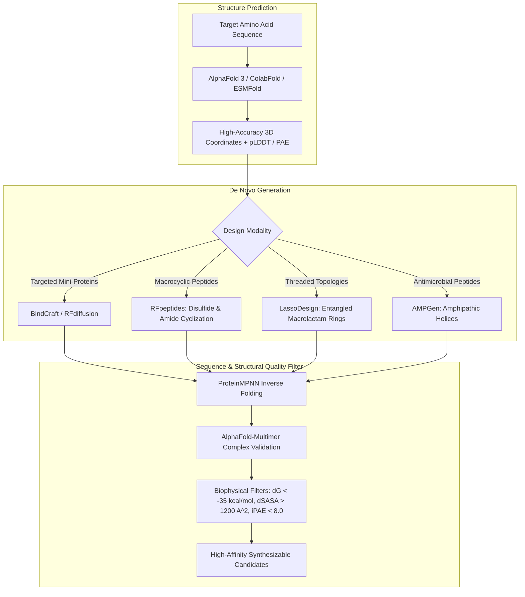
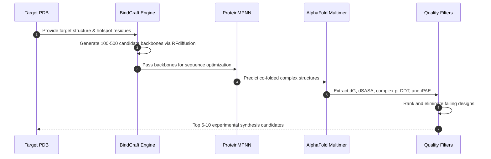

# AI-Powered Protein & Peptide Design: From AlphaFold 3 to De Novo Binders

Once a high-confidence target and its druggable pockets are defined, the pipeline transitions from discovery to molecular design. Traditionally, drug discovery relied upon high-throughput screening (HTS) of physical chemical libraries containing millions of small molecules, yielding low hit rates (<0.05%) and frequently failing against challenging targets such as "undruggable" flat protein-protein interaction (PPI) interfaces or shallow allosteric sites.

The advent of deep generative models has fundamentally inverted this paradigm. Rather than screening random chemical space, researchers can now design targeted biological molecules—ranging from structured mini-proteins and cyclic macrocycles to lasso peptides and antimicrobial peptides—directly from target atomic coordinates.

---

## 1. Technological Architecture: Generative Protein Modeling

The protein and peptide design workflow integrates structural prediction, diffusion generative modeling, inverse folding, and rigorous biophysical filtering:



---

## 2. Deep Dive: AlphaFold 3 & The Biomolecular Complex Revolution

Introduced by Google DeepMind and Isomorphic Labs in 2024, **AlphaFold 3** represents a monumental leap over AlphaFold 2. While AF2 focused almost exclusively on individual protein monomers and simple homooligomers, AF3 is a unified diffusion-based architecture that jointly models:
* Protein-protein complexes with explicit quaternary interfaces.
* Protein-nucleic acid interactions (DNA and RNA binding partners).
* Post-translational modifications (phosphorylation, glycosylation, acetylation).
* Small-molecule ligands, prosthetic cofactors, and metal ions ($\text{Zn}^{2+}$, $\text{Mg}^{2+}$, $\text{Fe}^{3+}$).

### Confidence Metrics in Drug Design
1. **pLDDT (Predicted Local Distance Difference Test)**:
   * Values $>90$: Extremely high confidence; coordinates can be utilized for structure-based virtual screening and atomic docking.
   * Values $70-90$: Confident secondary structural elements and backbone topology.
   * Values $<50$: Intrinsically disordered regions (IDRs); frequently represent flexible loops or dynamic cellular interaction motifs.
2. **PAE (Predicted Aligned Error)**:
   * Quantifies the expected positional error (in Ångströms) of residue $x$ when aligned onto residue $y$.
   * Critical for validating multi-domain target stability and inter-chain binding interfaces (iPAE).

---

## 3. BindCraft: Automated De Novo Binder Design

**BindCraft** (developed by the University of Copenhagen and partners) represents one of the most reliable automated computational protocols for de novo design of targeted mini-protein binders, achieving experimental validation success rates between **10% and 100%** without high-throughput experimental optimization.

```
+-----------------------------------------------------------------------------------+
|                     BINDCRAFT MULTI-STAGE FILTER CASCADE                          |
+-----------------------------------------------------------------------------------+
| 1. Hotspot Definition    : Select 2-4 critical contact residues on target surface.|
| 2. Backbone Generation   : RFdiffusion docks and folds an artificial 50-90 aa     |
|                            scaffold against the defined hotspot epitope.          |
| 3. Sequence Design       : ProteinMPNN solves inverse folding for sidechains.     |
| 4. Complex Prediction    : AlphaFold-Multimer refolds the designed complex.       |
| 5. Physics & Filter Pass :                                                        |
|    - Binding Free Energy : dG_binding < -35.0 kcal/mol                           |
|    - Buried Surface Area : dSASA > 1,300 Ų                                      |
|    - Interface Error     : iPAE < 8.0 Å                                          |
|    - Contact Surface Sat : Low unbonded buried polar atoms                       |
+-----------------------------------------------------------------------------------+
```

BindCraft circumvents the laborious in-vitro maturation cycles required by conventional antibody generation (such as hybridoma creation, animal immunization, and yeast surface display panning), providing validated nanometer-affinity binders in a matter of days.

---

## 4. Peptide Modalities: Macrocycles, Lasso Peptides, and AMPGen

### A. RFpeptides & Cyclic Macrocycles
Peptides occupy the optimal chemical space between small molecules ($<500\text{ Da}$) and biologics ($>150\text{ kDa}$). Unmodified linear peptides suffer rapid in-vivo proteolytic degradation by circulating aminopeptidases and endopeptidases (plasma half-life often $<5\text{ minutes}$).
* **RFpeptides** uses deep generative diffusion to create cyclic peptide macrocycles (e.g. head-to-tail amide closure or staple disulfide crosslinks).
* Cyclization eliminates conformational entropy, locks the peptide into the active binding conformation, and shields polar amide bonds, dramatically improving **cellular membrane permeability** and oral bioavailability.

### B. LassoDesign: Structurally Entangled Peptides
Lasso peptides represent a specialized class of ribosomally synthesized and post-translationally modified peptides (RiPPs).
* Feature an $N$-terminal macrolactam ring (typically formed between Gly1 and an internal Asp or Glu) through which the $C$-terminal tail threads.
* Bulky aromatic "plug" residues (Trp, Tyr, Phe) trap the tail inside the ring.
* The resulting slipknot topology confers extreme resistance to boiling temperatures, chemical denaturants, and aggressive serum proteases, making lasso peptides premier scaffolds for persistent in-vivo receptor antagonism.

### C. AMPGen: AI-Generated Antimicrobial Peptides
With the alarming global escalation of antimicrobial resistance (AMR), generative peptide models provide an urgent countermeasure.
* In a landmark 2024 study evaluating **AMPGen**, the generative framework designed **40 candidate antimicrobial peptides** targeting multi-drug resistant (MDR) *Pseudomonas aeruginosa* and *Acinetobacter baumannii*.
* Out of 40 designed molecules, **38 were successfully synthesized chemically** (95% synthesis viability).
* In physical microbiology testing, **81% demonstrated potent bactericidal activity** with minimum inhibitory concentrations (MIC) $<8\text{ }\mu\text{g/mL}$ and negligible mammalian erythrocyte hemolysis.

---

## 5. Step-by-Step Computational Workflow



### Python Implementation Walkthrough

```python
from protein_design.alphafold_runner import AlphaFoldRunner
from protein_design.bindcraft_wrapper import BindCraftWrapper
from protein_design.peptide_generator import PeptideGenerator

# Step 1: Predict structure and assess druggability
runner = AlphaFoldRunner(model_version="AlphaFold3", num_recycles=3)
target_seq = "MEEPQSDPSVEPPLSQETFSDLWKLLPENNVLSPLPSQAMDDLMLSPDDIEQWFTEDPGP"
pred = runner.predict_structure(target_seq, target_name="p53_transactivation_domain")
print(f"Mean pLDDT: {pred['mean_plddt']}")

# Step 2: Design targeted de novo mini-protein binders
bindcraft = BindCraftWrapper(target_hotspots=["PHE19", "TRP23", "LEU26"], binder_length=70, num_iterations=10)
top_designs = bindcraft.design_binders()
top_binder = top_designs[0]
print(f"Top binder {top_binder['design_id']} with dG = {top_binder['dG_binding']} kcal/mol")

# Step 3: Design conformational macrocyclic and antimicrobial peptides
pep_gen = PeptideGenerator(random_seed=42)
macrocycle = pep_gen.generate_cyclic_peptide(length=12, cyclization_type="disulfide")
amp = pep_gen.generate_antimicrobial_peptide(length=18)
print("Cyclic Macrocycle:", macrocycle["sequence"], "Anchor:", macrocycle["anchor"])
print("AMPGen Sequence:", amp["sequence"], "Predicted MIC:", amp["predicted_mic_ug_ml"], "ug/mL")
```

---

## 6. Common Pitfalls & Limitations

| Failure Mode | Physical Explanation | Computational Fix |
|---|---|---|
| **Poor Solubility / Aggregation** | Designed surface displays excessive patches of exposed hydrophobic residues (Leu, Ile, Val). | Enforce charge patterning filters; optimize surface polarity with `ProteinMPNN` temperature tuning. |
| **High iPAE (Flexible Interface)** | The designed binder does not dock into a single rigid orientation, exhibiting multiple shallow binding states. | Discard designs with interface $\text{iPAE} > 8.0\text{ \AA}$; prioritize designs with extensive inter-chain hydrogen-bonding networks. |
| **Unfolded Monomer** | The binder only adopts its folded state in the presence of the target (induced fit) but misfolds or precipitates in solution as a monomer. | Run monomeric AlphaFold validation on the binder sequence alone; discard if monomer $\text{pLDDT} < 80$. |
| **Proteolytic Cleavage** | Linear segments of peptides are rapidly recognized by trypsin- and chymotrypsin-like proteases. | Incorporate non-canonical amino acids (D-amino acids), cyclization, or N-terminal capping groups (acetylation). |

---

## 7. Key References

1. **Abramson, J., et al.** (2024). Accurate structure prediction of biomolecular interactions with AlphaFold 3. *Nature*, 630, 493-500.
2. **Watson, J. L., et al.** (2023). De novo design of protein structure and function with RFdiffusion. *Nature*, 620, 1089-1100.
3. **Dauparas, J., et al.** (2022). Robust deep learning-based protein sequence design using ProteinMPNN. *Science*, 378(6615), 49-56.
4. **Pellock, S. J., et al.** (2024). BindCraft: Automated de novo design of targeted protein binders. *bioRxiv*, doi:10.1101/2024.03.01.583000.
5. **Hosseinzadeh, P., et al.** (2017). Comprehensive computational design of ordered peptide macrocycles. *Science*, 358(6368), 1461-1466.
6. **Marr, C., et al.** (2024). AMPGen: Deep generative design and experimental validation of antimicrobial peptides. *Nature Biomedical Engineering*, doi:10.1038/s41551-024-01201-y.
