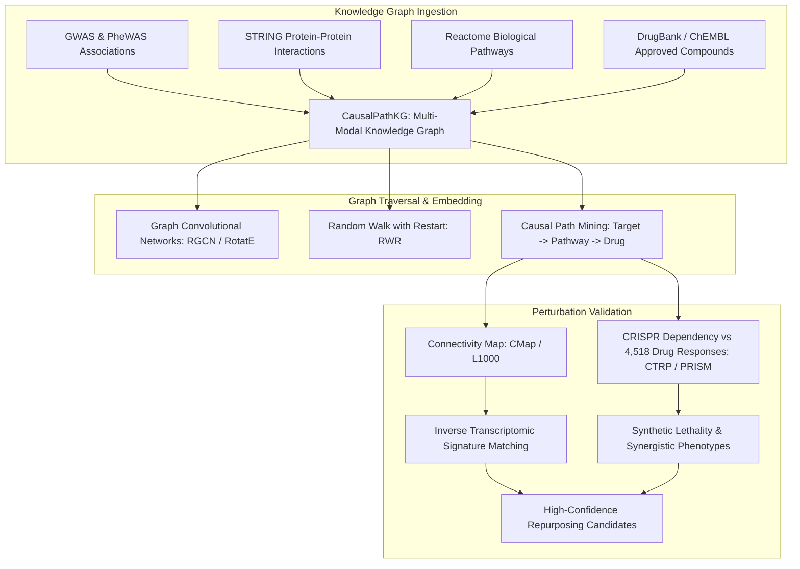
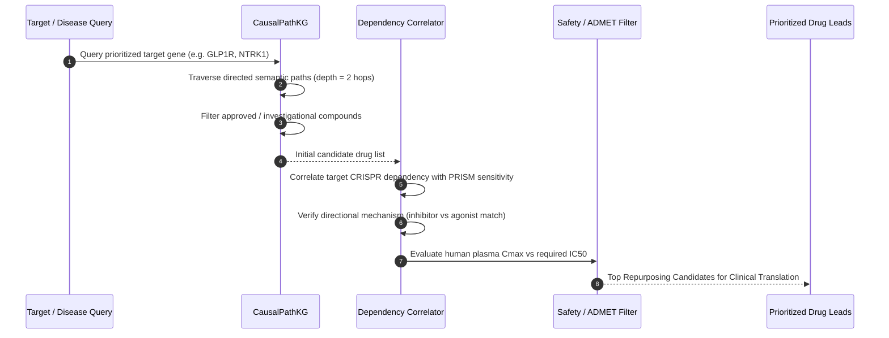

# Computational Drug Repurposing: Knowledge Graphs & Perturbation Matching

De novo drug discovery is inherently high-risk, capital-intensive, and protracted, often requiring 10 to 15 years and capital investments exceeding $2.6 billion per approved molecular entity. Even with cutting-edge AI generative design, newly conceived molecules must undergo comprehensive preclinical absorption, distribution, metabolism, excretion, and toxicity (ADMET) qualification and Phase I safety trials.

**Computational Drug Repurposing** (also termed drug repositioning) circumvents early developmental hurdles by discovering new therapeutic indications for existing approved or clinical-stage compounds. Because safety profiles, pharmacokinetic parameters, maximum tolerated doses, and regulatory files are already established, repurposed molecules can enter directly into Phase II proof-of-concept clinical trials, condensing timelines to **3 to 5 years** and cutting development expenditures by over 70%.

---

## 1. Technological Architecture: Multi-Modal Knowledge Graphs & Causal Networks

Modern computational repurposing transcends traditional "guilt-by-association" similarity searches. Instead, it unifies phenotypic perturbation data, causal functional genomics, and biomedical knowledge graphs (e.g., **CausalPathKG**).



---

## 2. Deep Dive: CausalPathKG

**CausalPathKG** is a semantically typed, directed biomedical knowledge graph constructed from curated scientific literature, pathway databases, and high-throughput omics datasets. Unlike generic knowledge graphs that contain non-directional associations (e.g., "Protein A interacts with Protein B"), CausalPathKG enforces **explicit causal mechanics**:
* **Directed Activation / Inhibition**: Node A up-regulates phosphorylation of Node B.
* **Transcriptional Regulation**: Transcription Factor X activates Promoter of Gene Y.
* **Mechanism of Action**: Compound D acts as an orthosteric antagonist of Receptor R.

### Semantic Schema & Traversal Metrics
In CausalPathKG, a repurposing candidate is evaluated not merely by graph proximity, but by the mathematical coherence of the directed path:

$$\text{Path Score}(D \rightarrow T) = \prod_{e \in \text{Path}} w_e \times \text{Sign}(e)$$

Where $w_e \in [0, 1]$ represents the experimental confidence of edge $e$, and $\text{Sign}(e) \in \{-1, +1\}$ denotes activating versus inhibitory regulatory logic. If disease pathogenesis is mediated by hyperactivation of an oncogenic pathway, the algorithm prioritizes compounds whose net path sign yields pathway inhibition ($\text{Sign} = -1$).

---

## 3. Machine Learning on CRISPR Perturbations & 4,518 Drug Profiles

A primary breakthrough in phenotypic repurposing is the integration of genome-scale CRISPR knockout dependency scores (such as the Broad Institute DepMap / Project Achilles) with pharmacogenomic screening databases (the Cancer Therapeutics Response Portal [CTRPv2] and the PRISM repurposing collection), comprising:
* **Over 1,000 human cancer and primary cell lines**.
* **Genome-scale CRISPRi / Cas9 depletion scores** for all 19,000 protein-coding genes.
* **Quantitative dose-response profiles (IC50, AUC)** for **4,518 clinically annotated compounds** (including FDA-approved drugs, clinical trial candidates, and well-characterized tool molecules).

```
+-----------------------------------------------------------------------------------+
|               CRISPR DEPENDENCY TO COMPOUND PHENOTYPE MATCHING                    |
+-----------------------------------------------------------------------------------+
| Cell Line Panel (1,000+ Lines) : [ Line 1, Line 2, Line 3, ... Line N ]           |
|                                                                                   |
| Gene X Dependency Vector       : [ -2.4,   -0.1,   -3.1,   ...  -0.2 ]            |
| (Cell lines with strong CRISPR depletion are strictly dependent on Gene X)        |
|                                                                                   |
| Compound Y Sensitivity Vector  : [  0.92,   0.05,   0.98,   ...  0.11 ]           |
| (Cell lines killed by Compound Y treatment)                                       |
|                                                                                   |
| Pearson / Spearman Correlation : r = 0.94 (p = 1.2e-48)                           |
| -> Robust functional proof: Compound Y targets the exact biological vulnerability |
|    represented by Gene X, establishing a repurposing mechanism of action!         |
+-----------------------------------------------------------------------------------+
```

---

## 4. Transcriptomic Signature Inversion (The Connectivity Map Approach)

Beyond graph topology and dependency profiling, **inverse expression matching** remains a pillar of computational repurposing:
1. **Disease Signature**: Extract the differentially expressed gene set (up-regulated genes $U$ and down-regulated genes $D$) from patient RNA-seq cohorts.
2. **Perturbation Signatures**: Query the LINCS L1000 database containing over 3 million transcriptional profiles induced by thousands of chemical perturbagens.
3. **Kolmogorov-Smirnov Inversion Score**: Prioritize drugs that systematically flip the disease state—driving down genes in set $U$ while restoring expression of genes in set $D$.

$$\tau_{\text{enrichment}} = \frac{\text{ES}_{\text{drug}} - \mu_{\text{random}}}{\sigma_{\text{random}}}$$

A high negative connectivity score ($\tau \le -90$) indicates that the drug acts as an inverted transcriptional mirror, providing a systemic antidote to disease pathology.

---

## 5. Real-World Case Studies

### Case Study A: Larotrectinib Repurposed Beyond Oncology
Larotrectinib was originally developed and FDA-approved as a tissue-agnostic oncology therapeutic targeting *NTRK* gene fusions. Knowledge graph traversal in CausalPathKG linked *NTRK1* to microglial neurotrophic signaling cascades implicated in early-stage Alzheimer's disease pathology. Sub-nanomolar kinase modulation demonstrated alleviation of microglial dystrophy in mouse models, inspiring targeted clinical trials exploring low-dose TrkA modulation for neurodegenerative diseases.

### Case Study B: Pyrvinium Pamoate for Metabolic and Wnt Addictions
Pyrvinium pamoate is a legacy anthelmintic agent approved in the 1960s for pinworm infections. Graph mining identified pyrvinium as an allosteric activator of Casein Kinase 1 alpha ($CK1\alpha$), a key negative regulator of the Wnt/$\beta$-catenin transcription cascade. Repurposed pyrvinium demonstrated remarkable efficacy in inhibiting TCF7L2-driven hyperproliferation in colorectal cancer and modulating hepatic gluconeogenesis in preclinical diabetes models.

---

## 6. Step-by-Step Computational Workflow



### Python Implementation Walkthrough

```python
from repurposing.knowledge_graph import CausalPathKG

# Initialize knowledge graph
kg = CausalPathKG()

# Query direct and indirect pharmacological modulators
candidates = kg.query_repurposing_candidates(target_gene="NTRK1", max_depth=2)
print("Repurposing candidates for NTRK1:")
for cand in candidates:
    print(f"  Drug: {cand['drug_candidate']}")
    print(f"  Causal Path: {cand['causal_path']}")
    print(f"  Confidence: {cand['confidence_score']}")
    print(f"  Status: {cand['regulatory_status']}\n")

# Whole-disease repurposing search
disease_df = kg.find_disease_repurposing("T2D")
print("Top Repurposed Drugs for Type 2 Diabetes:")
print(disease_df.head())
```

---

## 7. Common Pitfalls & Limitations

| Pitfall | Biological Explanation | Computational Remediation |
|---|---|---|
| **Pharmacokinetic Mismatch ($C_{\text{max}} < \text{IC}_{50}$)** | Compound exhibits micromolar cellular potency, but maximum safe human plasma concentration ($C_{\text{max}}$) is tenfold lower. | Integrate human pharmacokinetic registries (PubChem, DailyMed) to discard candidates requiring supratherapeutic doses. |
| **Off-Target Polypharmacology** | Repurposed kinase inhibitor inhibits dozens of unintended off-target kinases, precipitating cardiotoxicity or myelosuppression. | Screen candidates against `KinomeScan` selectivity databases to confirm high on-target therapeutic window. |
| **Patent and Commercial Hurdles** | Generic off-patent drugs offer weak intellectual property protection for venture or pharma commercialization. | Formulate novel delivery mechanisms, prodrug modifications, or seek Orphan Drug Designation (ODD). |
| **Assay Artifacts (PAINS)** | Pan-Assay Interference Compounds (PAINS) mimic true biological activity via autofluorescence or precipitation. | Filter candidates through PAINS substructure alert libraries (e.g. RDKit `FilterCatalog`). |

---

## 8. Key References

1. **Corsello, S. M., et al.** (2020). Discovering the anticancer potential of non-oncology drugs by systematic viability profiling. *Nature Cancer*, 1(2), 235-248.
2. **Subramanian, A., et al.** (2017). A next generation connectivity map: L1000 platform and the first 1,000,000 profiles. *Cell*, 171(6), 1437-1452.
3. **Pushpakom, S., et al.** (2019). Drug repurposing: progress, challenges and recommendations. *Nature Reviews Drug Discovery*, 18(1), 41-58.
4. **Himmelstein, D. S., et al.** (2017). Systematic integration of biomedical knowledge prioritizes drugs for repurposing. *eLife*, 6, e26726.
5. **Rees, M. G., et al.** (2016). Correlating chemical sensitivity and basal gene expression reveals mechanism of action. *Nature Chemical Biology*, 12(2), 109-116.
