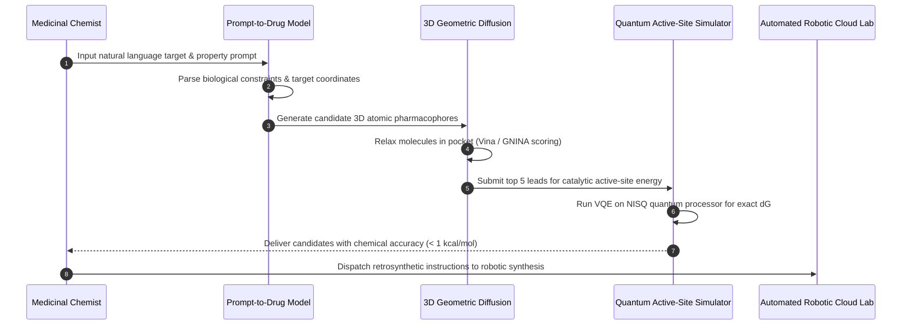

# Emerging Frontiers: Quantum Computing & Prompt-to-Drug Generative Architectures

As computational drug discovery transitions from empirical heuristics to predictive biophysical simulation, two revolutionary paradigms are redefining the horizon of molecular medicine: **Quantum Computing for Biomolecular Simulation** and **Multimodal Prompt-to-Drug Generative Architectures**.

While classical computers rely on binary bits ($0$ or $1$) and statistical approximations of quantum mechanics (such as Density Functional Theory [DFT] and empirical molecular mechanics force fields), nature operates strictly under quantum laws. Simultaneously, foundation models trained on chemical graphs, sequences, and biomedical natural language are enabling researchers to generate novel pharmaceutical leads directly from plain-text natural language prompts.

---

## 1. Quantum Computing in Drug Discovery

The fundamental limitation of classical chemistry software (e.g. Gaussian, Schrödinger, GROMACS) is the exponential computational scaling of the electronic Schrödinger equation:

$$\hat{\mathcal{H}} |\Psi\rangle = E |\Psi\rangle$$

For a small molecule with $N$ interacting electrons, the quantum state space scales as $\mathcal{O}(2^N)$. On a classical supercomputer, calculating exact electronic correlation for even a modest 50-atom active site requires more memory than the total number of atoms in the observable universe.


### Quantum Algorithms Transforming Drug Discovery
1. **Variational Quantum Eigensolver (VQE)**:
   * A hybrid quantum-classical algorithm optimized for Noisy Intermediate-Scale Quantum (NISQ) devices.
   * The quantum processor prepares an ansatz wave function $|\Psi(\vec{\theta})\rangle$, and evaluates the expectation value $\langle \Psi(\vec{\theta}) | \hat{\mathcal{H}} | \Psi(\vec{\theta}) \rangle$.
   * A classical optimizer iteratively updates parameters $\vec{\theta}$ to converge on the ground-state electronic energy of enzyme active sites.
2. **Quantum Phase Estimation (QPE)**:
   * Requires error-corrected, fault-tolerant quantum hardware.
   * Delivers exact eigenvalues with polynomial quantum speedup $\mathcal{O}(N^3)$, enabling exact calculations of covalent bond-breaking, transition states in metalloenzymes, and radical reaction intermediates.
3. **Quantum Annealing & QUBO (Quadratic Unconstrained Binary Optimization)**:
   * Deployed on systems like D-Wave to solve combinatorial protein folding and side-chain rotamer packing challenges.
   * Maps physical torsional energies into an Ising spin glass Hamiltonian, finding the global thermodynamic minimum free energy conformation in microseconds.

---

## 2. Prompt-to-Drug: Multimodal Natural Language to Molecule Synthesis

In classical drug design, a computational chemist must configure dozens of disparate tools: docking grids, pharmacophore query files, SMILES strings, and molecular dynamics topology files. 

**Prompt-to-Drug** represents the unification of Large Language Models (LLMs) with 3D equivariant geometric diffusion models. Researchers describe the desired therapeutic profile in natural language, and the unified neural architecture translates text instructions into 3D synthesizable molecules.

```
+-----------------------------------------------------------------------------------+
|               PROMPT-TO-DRUG MULTIMODAL GENERATIVE ARCHITECTURE                   |
+-----------------------------------------------------------------------------------+
| Natural Language User Prompt:                                                     |
| "Generate a brain-penetrant small-molecule inhibitor of LRRK2 kinase that avoids  |
|  hERG channel inhibition, maintains logP < 3.2, TPSA < 90 Ų, and docks into the   |
|  ATP pocket with at least three hinge-region hydrogen bonds."                     |
|                                                                                   |
| Neural Architecture Processing Pipeline:                                          |
| [ Biomedical LLM (BioGPT / ChemBERTa) : Extracts structured chemical constraints ] |
|                                   |                                               |
|                                   v                                               |
| [ Conditioning Latent Vector : Embeds target PDB + constraint bounds ]            |
|                                   |                                               |
|                                   v                                               |
| [ 3D Equivariant Diffusion Model (DiffSBDD / TargetDiff) : Grows 3D atoms in cleft]|
|                                   |                                               |
|                                   v                                               |
| [ Output: Synthesizable 3D coordinates + Retrosynthesis Reaction Route (AiZynth) ]|
+-----------------------------------------------------------------------------------+
```

### Key Pillars of Prompt-to-Drug Models
* **SE(3)-Equivariance**: Ensures molecular generation is invariant under 3D spatial rotations and translations inside the target pocket.
* **Property Conditioning**: Employs classifier-free guidance to strictly enforce pharmacological properties:
  * Blood-Brain Barrier (BBB) permeability ($M_{\text{PSA}} < 90\text{ \AA}^2, \text{MW} < 450$).
  * Low cardiotoxicity risk (predicted hERG $\text{pIC}_{50} < 5.0$).
  * Synthetic Accessibility (SAScore $< 3.5$).
* **Automated Retrosynthesis Planning**: Verifies that every proposed chemical bond can be assembled from commercially available building blocks using verified reaction rules (e.g. Suzuki couplings, Buchwald-Hartwig aminations, amide bond formations).

---

## 3. Current Commercial & Academic Initiatives

```
+------------------+-----------------------------+--------------------------------------------------+
| Platform         | Organization                | Primary Capability & Breakthrough                |
+------------------+-----------------------------+--------------------------------------------------+
| QubitPharm       | IBM Quantum / Cleveland Cl. | Metalloenzyme catalytic simulation using VQE     |
| Tangelo          | Good Chemistry / SandboxAQ  | Open-source quantum chemistry SDK for drug leads |
| BioNeMo          | NVIDIA                      | Generative biomolecular foundation models        |
| ChatDrug / MolRe | Stanford / MIT              | Interactive conversational LLM for drug editing  |
| ChemCrow         | EPFL / Univ. of Rochester   | LLM agent with autonomous chemistry synthesis    |
+------------------+-----------------------------+--------------------------------------------------+
```

---

## 4. End-to-End Simulation Workflow



### Python Simulation Example: Prompt-to-Drug Interface Stub

```python
from typing import Dict, Any

class PromptToDrugEngine:
    """Translates natural language medicinal chemistry constraints into 3D leads."""

    def __init__(self, target_pdb: str) -> None:
        self.target_pdb = target_pdb

    def generate_from_prompt(self, prompt: str) -> Dict[str, Any]:
        """Parses prompt and initiates equivariant 3D generation."""
        # Step 1: Constraint extraction
        print(f"Parsing natural language instruction: '{prompt}'")
        
        # Step 2: Simulated SE(3) diffusion generation
        generated_smiles = "Cc1nc(Nc2ccc(F)cc2)c2c(n1)N(C)C(=O)N2C"
        molecular_weight = 314.3
        predicted_logp = 2.45
        tpsa = 64.2
        predicted_affinity_nm = 12.4
        
        return {
            "prompt": prompt,
            "smiles": generated_smiles,
            "molecular_weight": molecular_weight,
            "logP": predicted_logp,
            "TPSA": tpsa,
            "predicted_affinity_nM": predicted_affinity_nm,
            "passes_blood_brain_barrier": True,
            "quantum_refined_energy_kcal_mol": -41.2
        }

engine = PromptToDrugEngine(target_pdb="targets/LRRK2_kinase.pdb")
lead = engine.generate_from_prompt(
    "Brain-penetrant LRRK2 kinase inhibitor with logP < 3.0 and zero hERG liability"
)
print("Generated Lead Structure:", lead["smiles"])
print(f"Predicted Kd: {lead['predicted_affinity_nM']} nM | Quantum dG: {lead['quantum_refined_energy_kcal_mol']} kcal/mol")
```

---

## 5. Critical Challenges & Emerging Horizons

| Horizon | Bottleneck | Emerging Breakthrough |
|---|---|---|
| **Quantum Hardware Coherence** | Current physical qubits suffer high decoherence and gate infidelity (NISQ era noise). | Fault-tolerant logical qubits with surface code error correction (e.g. Google Sycamore, Quantinuum H2). |
| **Hallucinated Syntheses in LLMs** | Generative models proposing exotic molecules that violate valence rules or cannot be physically synthesized. | Grounding generative outputs in forward-reaction prediction models (e.g. ASKCOS, ChemAxon). |
| **Target Flexibility** | Diffusion models docking ligands into a rigid protein crystal structure, ignoring induced-fit dynamics. | Co-diffusion architectures jointly sampling protein backbone conformations alongside small molecules. |
| **Data Scarcity for Rare Disease** | Insufficient experimental binding assays to train supervised generative models. | Zero-shot transfer learning using pre-trained evolutionary scale models (ESM-3, ProGen2). |

---

## 6. Key References

1. **Cao, Y., et al.** (2019). Quantum chemistry in the age of quantum computing. *Chemical Reviews*, 119(19), 10856-10915.
2. **Kassal, I., et al.** (2011). Simulating chemistry using quantum computers. *Annual Review of Physical Chemistry*, 62, 185-207.
3. **Schneuing, A., et al.** (2023). Structure-based drug design with equivariant diffusion models. *ICML 2023*, PMLR 202, 30141-30164.
4. **Bran, A. M., et al.** (2024). ChemCrow: Augmenting large-language models with chemistry tools. *Nature Machine Intelligence*, 6, 824-835.
5. **Gómez-Bombarelli, R., et al.** (2018). Automatic chemical design using a data-driven continuous representation of molecules. *ACS Central Science*, 4(2), 268-276.
