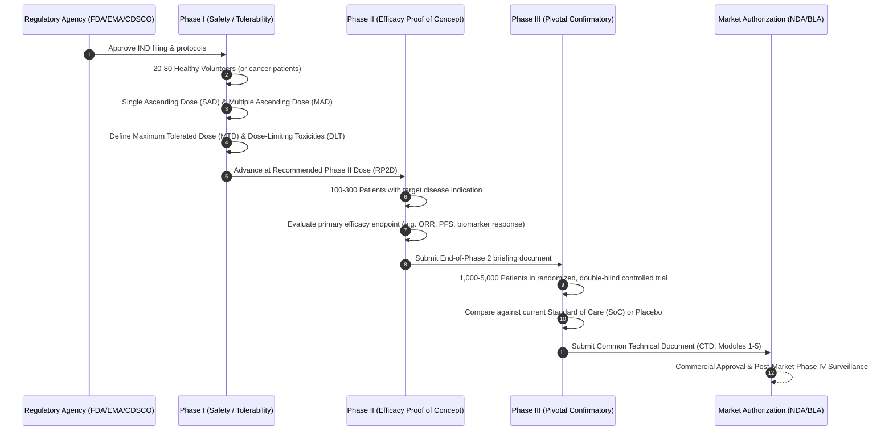

# Preclinical Validation & Regulatory Pathways: From In-Vitro to Clinical Trials

The output of computational genetics, functional genomics, and AI molecular design is an in-silico hypothesis. Transforming a computationally designed lead into an approved medicine requires rigorous translational validation traversing biochemical assays, cellular phenotyping, animal disease models, and multi-phase human clinical trials governed by global regulatory authorities.

This guide provides a comprehensive roadmap for preclinical and clinical development, detailing the mandatory developmental gateways, Investigational New Drug (IND) filing requirements, and regulatory harmonization across the **US FDA**, European **EMA**, and Indian **CDSCO**.

---

## 1. The Preclinical to Clinical Continuum

```mermaid
flowchart LR
    subgraph P1 [Preclinical Stage 1: In-Vitro]
        A[Surface Plasmon Resonance SPR / BLI] --> B[Cell Viability & Potency IC50]
        B --> C[ADMET Profiling: CYP450, hERG, Caco-2]
    end
    
    subgraph P2 [Preclinical Stage 2: In-Vivo]
        C --> D[PK/PD in Rodents & Non-Rodents]
        D --> E[Efficacy in Disease Models]
        E --> F[GLP Toxicology & Safety Pharmacology]
    end
    
    subgraph REG [Regulatory Filing]
        F --> G[IND / CTA Submission: FDA, EMA, CDSCO]
    end
    
    subgraph CLIN [Clinical Development]
        G --> H[Phase I: Healthy Volunteer Safety & Dose Escalation]
        H --> I[Phase II: Patient Proof of Concept & Dose Finding]
        I --> J[Phase III: Pivotal Multi-Center Confirmatory Trials]
        J --> K[NDA / BLA Approval & Market Launch]
    end
```



---

## 2. In-Vitro Biophysical & Biochemical Validation

Before advancing a designed molecule into animal studies, its direct physical engagement with the purified target must be unequivocally proven.

### Primary Assays & Analytical Thresholds
1. **Target Binding Affinity ($K_d$)**:
   * **Surface Plasmon Resonance (SPR)** and **Bio-Layer Interferometry (BLI)**: Measure real-time association rate ($k_{\text{on}}$) and dissociation rate ($k_{\text{off}}$).
   * *Gateway Requirement*: Designed biologics and peptides must achieve $K_d < 10\text{ nM}$; small molecules must demonstrate $K_d < 100\text{ nM}$.
2. **Cellular Thermal Shift Assay (CETSA)**:
   * Assesses target engagement inside living cells by measuring the thermal stabilization of the target protein in the presence of the drug.
   * Prevents false-positive leads that bind purified recombinant protein in cell-free buffers but fail to bind the target within the crowded intracellular milieu.
3. **In-Vitro ADMET Screening**:
   * **Metabolic Stability**: Incubation with human liver microsomes (HLM) to determine intrinsic clearance ($CL_{\text{int}}$) and half-life ($t_{1/2}$).
   * **Membrane Permeability**: Caco-2 monolayer bidirectional flux assay ($P_{\text{app}} > 10 \times 10^{-6}\text{ cm/s}$ indicates high human intestinal absorption).
   * **Cardiotoxicity Screening**: Automated patch-clamp assay against human Ether-à-go-go-Related Gene (hERG) potassium channels ($\text{IC}_{50} > 30\text{ }\mu\text{M}$ required to eliminate QT-prolongation arrhythmias).

---

## 3. In-Vivo Pharmacokinetics, Efficacy & Toxicology

```
+-----------------------------------------------------------------------------------+
|               PRECLINICAL IN-VIVO TRANSLATIONAL GATES                             |
+-----------------------------------------------------------------------------------+
| Gate 1: Pharmacokinetics (PK) & Bioavailability (F)                              |
| - Minimum requirements: Oral bioavailability F > 30% (for oral small molecules),   |
|   plasma half-life t1/2 > 6 hours in rodents, clear dose-proportional exposure.  |
|                                                                                   |
| Gate 2: In-Vivo Disease Efficacy Models                                           |
| - Target engagement verified in diseased tissue (e.g. tumor xenograft regression, |
|   HbA1c reduction in diabetic db/db mice, or amyloid plaque clearance in 5xFAD).  |
|                                                                                   |
| Gate 3: Good Laboratory Practice (GLP) Toxicology                                 |
| - 28-day repeat-dose toxicity in two mammalian species (one rodent, one non-rodent)|
| - Establish No Observed Adverse Effect Level (NOAEL) to calculate First-In-Human   |
|   Maximum Recommended Starting Dose (MRSD).                                       |
+-----------------------------------------------------------------------------------+
```

---

## 4. Regulatory Frameworks: FDA vs EMA vs CDSCO

Advancing from preclinical experiments into human trials requires regulatory authorization. While the scientific principles are globally harmonized under the **International Council for Harmonisation (ICH)**, regional authorities maintain specific statutory filing structures:

| Metric / Dimension | US FDA | European Medicines Agency (EMA) | Central Drugs Standard Control Organisation (CDSCO - India) |
|---|---|---|---|
| **Regulatory Filing** | Investigational New Drug (IND) | Clinical Trial Application (CTA) via CTIS | Form CT-04 (Clinical Trial Permission) |
| **Primary Legislation** | 21 CFR Part 312 | EU Clinical Trials Regulation (CTR 536/2014) | New Drugs and Clinical Trials Rules (NDCT 2019) |
| **Review Timelines** | 30-day statutory default (passive clearance) | 60 to 106 days (active decision required) | 90 days for global trials; 30 days for Indian-discovered molecules |
| **Local Clinical Data** | Accepts foreign clinical data if ICH-compliant | Accepts foreign data under GCP standards | Mandatory Phase III data generated within Indian populations |
| **Expedited Tracks** | Fast Track, Breakthrough Therapy, Priority Review, Accelerated Approval | PRIME (Priority Medicines), Conditional Marketing Authorisation | Accelerated Approval Process, Expedited Review for unmet needs |

---

## 5. Human Clinical Trial Architecture (Phases I through IV)



---

## 6. Preclinical Qualification Checklist for AI-Generated Molecules

Before preparing an IND filing for a de novo designed therapeutic, the development team must compile a comprehensive technical dossier:

* [ ] **Target Validation Evidence**: Cross-ancestry genetic association (GWAS), gene-burden significance ($p < 2.5 \times 10^{-6}$), and xQTL colocalization ($\text{PPH}_4 \ge 0.80$).
* [ ] **Biophysical Target Engagement**: Recombinant SPR/BLI affinity curves showing reproducible binding constants.
* [ ] **Selectivity Panel**: Comprehensive off-target kinase, GPCR (SafetyScreen44), and ion channel liability panels demonstrating $>100$-fold therapeutic window.
* [ ] **Chemistry, Manufacturing, and Controls (CMC)**: Scalable synthesis route ($>98\%$ purity via HPLC), defined salt/crystalline form, stability testing under accelerated ICH temperature/humidity conditions.
* [ ] **GLP Toxicology & Safety Pharmacology**: Cardiovascular (telemetry dog/cynomolgus), respiratory (plethysmography), and central nervous system (Irwin test) assessments.
* [ ] **First-in-Human Dose Calculation**: Extrapolation from species NOAEL using human equivalent dose (HED) scaling and a minimum $10\times$ safety factor.

---

## 7. Key References

1. **Food and Drug Administration (FDA)** (2022). *Guidance for Industry: Preclinical Assessment of Investigational New Drugs*. U.S. Department of Health and Human Services.
2. **European Medicines Agency (EMA)** (2021). *Guideline on strategies to identify and mitigate risks for first-in-human and early clinical trials with investigational medicinal products*. EMEA/CHMP/SWP/28367/07 Rev. 1.
3. **Ministry of Health and Family Welfare (CDSCO)** (2019). *New Drugs and Clinical Trials Rules (NDCT)*. The Gazette of India, CG-DL-E-19032019-200732.
4. **Wong, C. H., Siah, K. W., & Lo, A. W.** (2019). Estimation of clinical trial success rates and related parameters. *Biostatistics*, 20(2), 273-286.
5. **DiMasi, J. A., Grabowski, H. G., & Hansen, R. W.** (2016). Innovation in the pharmaceutical industry: New estimates of R&D costs. *Journal of Health Economics*, 47, 20-33.
