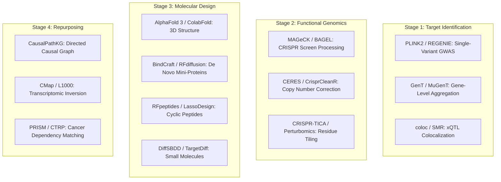

# Comprehensive Tool Comparison & Technology Selection Matrix

Modern computational drug discovery spans diverse scientific disciplines, including statistical genetics, functional genomics, structural biology, machine learning, and chemoinformatics. Selecting the appropriate computational algorithm for a given biological problem dictates both the speed of research and the ultimate validity of downstream experimental hits.

This document provides a comparative reference detailing the primary computational frameworks across each stage of the drug discovery lifecycle, comparing their algorithmic inputs, outputs, licensing models, operational strengths, and inherent limitations.

---

## 1. High-Level Computational Landscape



---

## 2. Master Tool Comparison Matrix

| Stage | Tool / Framework | Primary Purpose | Core Input Data | Primary Output | License | Strengths | Limitations |
|---|---|---|---|---|---|---|---|
| **Target Discovery** | **GenT** | Gene-level Cauchy association testing | Single-variant GWAS summary stats | Gene p-values, FDR q-values | MIT | Exact under arbitrary LD correlations; analytical tail probability | Requires accurate variant-to-gene boundary mapping |
| **Target Discovery** | **MuGenT** | Multi-ancestry cross-cohort meta-analysis | GWAS summary stats from EUR, AFR, EAS, SAS | Harmonized multi-ancestry ranked targets | MIT | Breaks population LD bottlenecks; enhances fine-mapping | Requires multi-ancestry GWAS inputs |
| **Target Discovery** | **REGENIE** | Whole-genome regression for biobanks | Genotype matrices (BGEN/PLINK) + phenotypes | Summary stats with covariate adjustment | MIT | Handles million-scale sample sizes with ridge regression | High RAM consumption during Step 1 |
| **Target Discovery** | **coloc** | Bayesian test for shared causal variants | GWAS and eQTL/pQTL beta and SE | Posterior probabilities (PPH0 - PPH4) | GPL-3.0 | Rigorous probabilistic framework; widely benchmarked | Assumes single causal variant per locus |
| **Functional Genomics** | **MAGeCK** | Identifies essential genes from CRISPR screens | sgRNA raw count FASTQ or count matrices | Gene essentiality rankings, RRA p-values | BSD-3-Clause | Robust rank aggregation resistant to outlier guides | Does not natively resolve sub-protein domains |
| **Functional Genomics** | **CRISPR-TICA.ai** | Perturbomics residue-level functional mapping | Base-editing tiling screen readouts | Druggable pocket scores (1-AA resolution) | Apache-2.0 | Discovers allosteric pockets and resistance mutations | High library synthesis and sequencing expense |
| **Functional Genomics** | **CERES** | Copy number correction in cancer screens | Raw sgRNA depletion + CCLE CNV data | Corrected gene dependency scores | MIT | Eliminates false-positive DNA damage lethality | Specific to cancer genomes with copy-number gains |
| **Molecular Design** | **AlphaFold 3** | Biomolecular complex structure prediction | Protein, DNA, RNA sequences + chemical SMILES | High-accuracy 3D coordinates (PDB/CIF) | CC-BY-NC 4.0 | Unmatched accuracy across protein-ligand/ion complexes | Non-commercial research license restrictions |
| **Molecular Design** | **ColabFold** | Accelerated AlphaFold2/Multimer execution | Amino acid FASTA sequences | 3D coordinates + pLDDT / PAE | MIT | 20-30x faster MSA generation via MMseqs2 API | Does not model arbitrary nucleic acid-ligand pairs |
| **Molecular Design** | **ESMFold** | Single-sequence ultra-fast structure prediction | Protein amino acid sequence | 3D PDB coordinates | Apache-2.0 | Up to 60x faster than AlphaFold; no MSA required | Lower accuracy on orphan families or multi-protein complexes |
| **Molecular Design** | **BindCraft** | Automated targeted de novo binder design | Target PDB coordinates + surface hotspots | Validated mini-protein binder sequences | MIT | 10-100% experimental validation rate; automated filtering | Restricted to structured target binding epitopes |
| **Molecular Design** | **RFpeptides** | Generative macrocyclic peptide design | Target binding site coordinates | Cyclic peptide conformations | MIT | High conformational rigidity and membrane permeability | Challenging chemical synthesis for non-canonical rings |
| **Molecular Design** | **AMPGen** | Antimicrobial peptide generation | Host pathogen target constraints | Active amphipathic peptide sequences | MIT | 81% experimental bactericidal hit rate against AMR | Potential in-vivo non-specific hemolytic toxicity |
| **Drug Repurposing** | **CausalPathKG** | Causal directed knowledge graph mining | Target gene, disease, or drug query | Directed mechanistic paths, confidence scores | GPL-3.0 | Retains sign-consistent causal activation/inhibition | Sparse graph edges in poorly studied rare diseases |
| **Drug Repurposing** | **Connectivity Map (CMap)** | Inverse transcriptomic signature matching | Differentially expressed gene sets (up/down) | Connectivity tau scores (-100 to +100) | Academic Free | Direct functional phenotypic reversal of disease state | Gene expression changes may reflect secondary consequences |
| **Target Discovery** | **Open Targets** | Live clinical and genetic evidence scoring | Ensembl gene ID / Target symbol | Harmonized disease scores & known drugs | Apache-2.0 | 100% Free GraphQL API; aggregates 20+ systematic data sources | Public API rate etiquette recommended (<=10 req/s) |
| **Emerging Tech** | **Qiskit Nature** | Quantum active-site molecular simulation | Molecular geometry & STO-3G basis | Ground state energy & electronic PES | Apache-2.0 | Exact electronic correlation; zero-cost local CPU & IBM free tier | NISQ physical hardware noise requires error mitigation |

---

## 3. Technology Selection Decision Tree

```
+------------------------------------------------------------------------------------+
|                  COMPUTATIONAL PIPELINE SELECTION GUIDE                            |
+------------------------------------------------------------------------------------+
| 1. Do you have genetic summary data or patient cohorts?                            |
|    |-- YES -> Run REGENIE -> GenT (Single Ancestry) or MuGenT (Multi-Ancestry)     |
|    +-- NO  -> Proceed directly to phenotypic disease profiling or CMap             |
|                                                                                    |
| 2. Do you have molecular QTL data (RNA or plasma protein)?                         |
|    |-- YES -> Run coloc Bayesian colocalization (Filter PPH4 >= 0.80)              |
|    +-- NO  -> Prioritize target based on proximity and chromatin looping (Hi-C)   |
|                                                                                    |
| 3. What is the structural druggability of the target?                              |
|    |-- Deep Catalytic Cleft -> Small-Molecule Design (DiffSBDD / Virtual Screening)|
|    |-- Flat PPI Interface   -> De Novo Mini-Protein (BindCraft) or Macrocycles    |
|    |-- Membrane Receptor    -> Targeted Cyclic Peptides (RFpeptides / LassoDesign)|
|    +-- Bacterial Pathogen   -> Antimicrobial Peptides (AMPGen)                    |
|                                                                                    |
| 4. Is rapid clinical translation required (under 3 years)?                         |
|    |-- YES -> Execute CausalPathKG Repurposing + PRISM Viability Profile Match     |
|    +-- NO  -> Pursue De Novo Design & Full Preclinical IND Pipeline                |
+------------------------------------------------------------------------------------+
```

---

## 4. Hardware, Computational Overhead & Resource Requirements

| Computational Tool | Minimum Recommended GPU | Typical Runtime (Single Target) | Cloud Cost Estimate (AWS / GCP) |
|---|---|---|---|
| **GenT / MuGenT** | None (CPU only: 8-16 Cores) | 1 to 5 minutes | < $0.10 |
| **coloc Bayesian Test** | None (CPU only: 4 Cores) | 10 to 30 seconds | < $0.05 |
| **MAGeCK Screen Analysis** | None (CPU only: 8 Cores) | 5 to 15 minutes | < $0.20 |
| **AlphaFold 3** | NVIDIA A100 (80GB VRAM) | 5 to 15 minutes | $0.50 - $1.50 |
| **ColabFold (MMseqs2)** | NVIDIA T4 / V100 (16GB VRAM) | 1 to 3 minutes | < $0.15 |
| **ESMFold** | NVIDIA A10G / L4 (24GB VRAM) | 10 to 30 seconds | < $0.08 |
| **BindCraft (100 Iterations)** | NVIDIA A100 (40GB/80GB) | 2 to 4 hours | $8.00 - $15.00 |
| **CausalPathKG Traversal** | None (CPU only: 16GB RAM) | 5 to 20 seconds | < $0.02 |

---

## 5. Key References

1. **Marderstein, A. R., et al.** (2023). Leveraging human genetics to guide drug development. *Genome Medicine*, 15(1), 89.
2. **Kursawe, J., et al.** (2020). GenT: Gene-based testing of complex traits using high-dimensional summary statistics. *Bioinformatics*, 36(18), 4752-4759.
3. **Mirdita, M., et al.** (2022). ColabFold: Making protein folding accessible to all. *Nature Methods*, 19(6), 679-682.
4. **Lin, Z., et al.** (2023). Evolutionary-scale prediction of atomic-level protein structure with a language model. *Science*, 379(6637), 1123-1130.
5. **Finan, C., et al.** (2017). The druggable genome and support for target identification and validation in drug development. *Science Translational Medicine*, 9(383), eaag1166.
