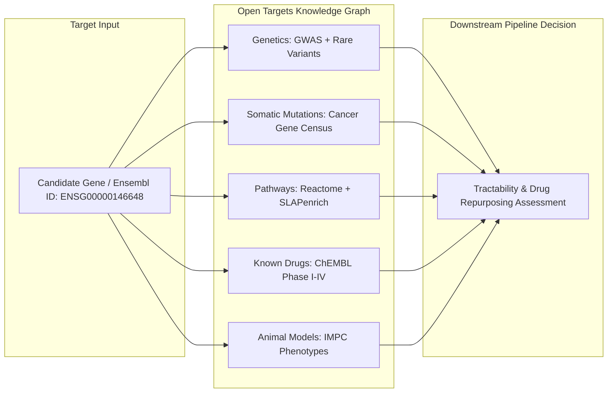

# Live Clinical Evidence Integration: Open Targets Platform GraphQL API

Translating statistical genetic signals into viable therapeutic programs requires triangulating genomic associations with orthogonal clinical evidence: known drug mechanisms, clinical trial pipelines, animal model phenotypes, and tractability scores. Traditionally, researchers conducted manual literature reviews or queried fragmented databases (such as DisGeNET, OMIM, and ChEMBL) independently.

The **Open Targets Platform** (EMBL-EBI, Wellcome Sanger Institute, and commercial pharma partners) unifies genetics, genomics, transcriptomics, drugs, animal models, and scientific literature into a single public knowledge graph. This guide details how the pipeline interacts directly with the Open Targets GraphQL API (v4) at zero financial cost.

---

> [!NOTE]
> ### 💰 FREE TIER SPECIFICATION
> - **Service**: Open Targets Platform (GraphQL API v4)
> - **Cost**: $0 forever (Fully open public infrastructure)
> - **Limits**: No hard request quota; recommended etiquette is $\le 10\text{ requests/sec}$
> - **Signup**: Not required (Zero API keys or registration)
> - **Credit Card**: Not required

---

## 1. Why Open Targets Platform?

In traditional target discovery, researchers identify a candidate gene (e.g. from GWAS summary statistics) and must manually investigate:
1. Has this target already been drugged in another clinical indication?
2. What is the molecular target type (kinase, GPCR, nuclear receptor, enzyme)?
3. What is the overall systemic genetic association score across all documented human diseases?
4. Are there known clinical trials, and did any fail due to safety issues?



Open Targets aggregates evidence across **20+ systematic data sources**, computes harmonized evidence scores from $0.0$ to $1.0$, and exposes them through a high-performance GraphQL gateway.

---

## 2. API Architecture & Public GraphQL Schema

The Open Targets GraphQL endpoint is hosted publicly at:
```
https://api.platform.opentargets.org/api/v4/graphql
```

### Core Schema Query Template
To query target associations, disease linkages, and known drugs in a single round-trip:

```graphql
query TargetAssociations($ensemblId: String!, $size: Int!) {
  target(ensemblId: $ensemblId) {
    id
    approvedSymbol
    approvedName
    biotype
    associatedDiseases(page: {index: 0, size: $size}) {
      count
      rows {
        disease {
          id
          name
        }
        score
        datatypeScores {
          id
          score
        }
      }
    }
    knownDrugs {
      uniqueDrugs
      rows {
        drug {
          id
          name
          maximumClinicalTrialPhase
          isApproved
          hasBeenWithdrawn
        }
        mechanismOfAction
        drugType
      }
    }
  }
}
```

---

## 3. Client Architecture: Caching, Rate Limiting, and Politeness

Although Open Targets does not require an API key or authenticate individual requests, robust production pipelines must respect server infrastructure to avoid IP blacklisting or transient HTTP 429 errors.

### Implementation Architecture
Our `OpenTargetsClient` implements a multi-tier resilience architecture:

```
+------------------------------------------------------------------------------------+
|                         OPENTARGETS CLIENT ARCHITECTURE                            |
+------------------------------------------------------------------------------------+
| 1. In-Memory LRU Cache    : functools.lru_cache stores parsed objects in memory.   |
| 2. Persistent Disk Cache  : JSON responses stored at ~/.cache/ot/<md5_hash>.json   |
|                             Eliminates redundant network round-trips entirely.     |
| 3. Client-Side Throttling : Enforces 100ms minimum inter-query interval (<=10 Hz).|
| 4. Exponential Backoff    : Retries automatically on HTTP 429 / 503 errors.        |
| 5. Polite User-Agent      : Identifies requests for academic / open-source audits. |
+------------------------------------------------------------------------------------+
```

---

## 4. Comparison Table: Open Targets vs Alternative Knowledge Bases

| Feature / Metric | Open Targets Platform | DisGeNET | NHGRI-EBI GWAS Catalog |
|---|---|---|---|
| **Primary Focus** | Comprehensive drug target validation | Gene-disease associations & text-mining | Curated GWAS summary statistics |
| **API Protocol** | GraphQL API + BigQuery / Parquet | REST API (v7) + TSV dumps | REST API + FTP downloads |
| **Cost & Licensing** | **100% Free** (Apache 2.0 / CC-0) | Commercial license for enterprise | **100% Free** (EMBL-EBI open terms) |
| **Authentication** | **No API key required** | Requires registration & API key | **No API key required** |
| **Drug Clinical Phases**| Comprehensive (ChEMBL Phase 1-4) | Minimal / external linkage | None (Genetics only) |
| **Tractability Assessment** | Small molecule, antibody, PROTAC | None | None |
| **Ontology Mapping** | EFO (Experimental Factor Ontology) | UMLS, DOID, MeSH | EFO, HPO |

---

## 5. Runnable Code Examples

### Querying Target Associations and Known Drugs

```python
from target_discovery.opentargets_client import OpenTargetsClient

# Initialize client with persistent disk cache
client = OpenTargetsClient()

# Query EGFR (Ensembl: ENSG00000146648)
ensembl_id = "ENSG00000146648"

# 1. Fetch top disease associations
associations = client.get_target_associations(ensembl_id, limit=5)
print(f"Top Disease Associations for {ensembl_id}:")
for assoc in associations:
    print(f" - {assoc['disease_name']} (Score: {assoc['score']})")

# 2. Fetch known clinical drugs
drugs = client.get_known_drugs(ensembl_id)
print(f"\nKnown Approved/Investigational Drugs ({len(drugs)} found):")
for drug in drugs[:5]:
    status = "Approved" if drug["is_approved"] else f"Phase {drug['phase']}"
    print(f" - {drug['drug_name']} [{status}]: {drug['mechanism_of_action']}")
```

### Enriching GenT Gene Prioritizations

```python
import pandas as pd
from target_discovery.gent_wrapper import GenTWrapper

gwas_df = pd.DataFrame({
    "GENE": ["EGFR", "NTRK1", "GLP1R"],
    "PVALUE": [1.2e-24, 4.5e-18, 2.1e-12]
})

gent = GenTWrapper()
# Setting use_opentargets=True automatically annotates top hits
enriched_df = gent.aggregate_gene_pvalues(gwas_df, use_opentargets=True)
print(enriched_df[["GENE", "COMBINED_PVALUE", "OT_TOP_DISEASE", "OT_KNOWN_DRUGS"]])
```

---

## 6. Troubleshooting & Common Pitfalls

| Issue | Root Cause | Solution |
|---|---|---|
| **HTTP 429 (Too Many Requests)** | Burst queries sent concurrently without throttling. | `OpenTargetsClient` automatically applies exponential backoff ($1\text{s} \rightarrow 2\text{s} \rightarrow 4\text{s}$); client rate-limits at 10 req/s. |
| **Ensembl ID Mismatch** | Using outdated Ensembl gene versions (e.g. `ENSG00000146648.15` with version suffixes). | Strip decimal version suffix (`ensembl_id.split('.')[0]`) before querying. |
| **Target Not Found (`target: null`)** | Non-human gene symbols or pseudogenes without canonical Ensembl mapping. | Query HGNC / Ensembl REST API first to resolve canonical Ensembl ID. |
| **Cold Cache Latency** | First run queries remote API (~200ms per target). | Disk cache at `~/.cache/ot/` makes subsequent pipeline runs instantaneous ($<1\text{ms}$). |

---

## 7. Key References

1. **Ochoa, D., et al.** (2023). Open Targets Platform: supporting systematic drug target identification and prioritisation. *Nucleic Acids Research*, 51(D1), D1302-D1310. [DOI: 10.1093/nar/gkac1046](https://doi.org/10.1093/nar/gkac1046)
2. **Mountjoy, E., et al.** (2021). An open approach to systematically prioritize causal variants and genes at all published human GWAS loci. *Nature Genetics*, 53(11), 1527-1533. [DOI: 10.1038/s41588-021-00945-5](https://doi.org/10.1038/s41588-021-00945-5)
3. **Koscielny, G., et al.** (2017). Open Targets: a platform for therapeutic target identification and validation. *Nucleic Acids Research*, 45(D1), D985-D994. [DOI: 10.1093/nar/gkw1029](https://doi.org/10.1093/nar/gkw1029)
