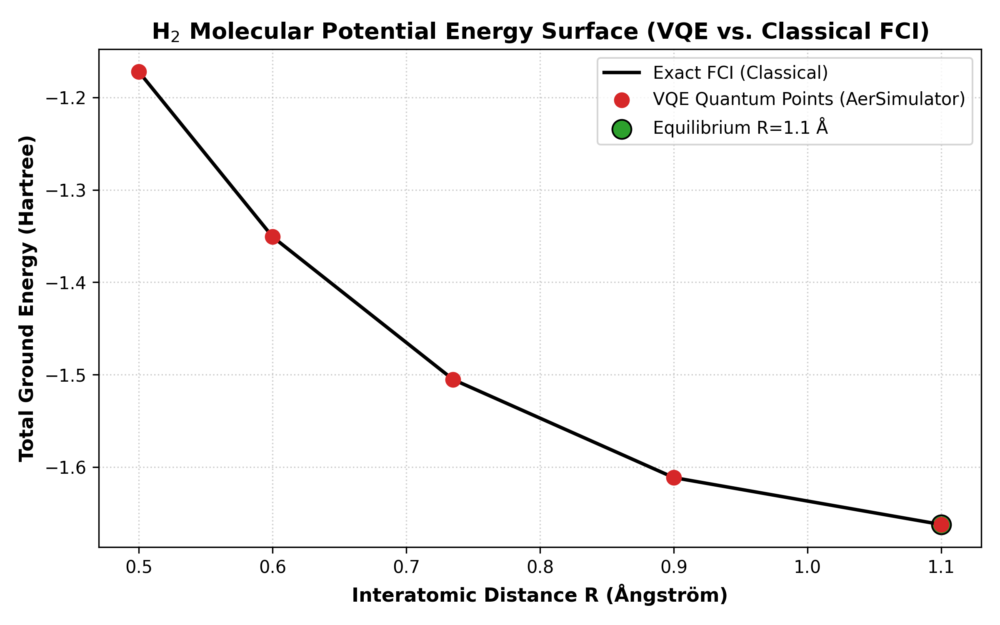

# Quantum Chemistry & Molecular Simulation: Qiskit Nature & VQE

Accurate computational modeling of catalytic active sites, transition states, and non-covalent drug-protein binding free energies has historically been constrained by the exponential scaling of the electronic Schrödinger equation on classical digital hardware. While empirical force fields (molecular mechanics) and Density Functional Theory (DFT) offer computationally tractable approximations, they routinely suffer from energy uncertainties between $\pm 3\text{ to }5\text{ kcal/mol}$. Because binding constants scale exponentially with free energy ($\Delta G = -RT \ln K_d$), an uncertainty of $3\text{ kcal/mol}$ translates to a **two-order-of-magnitude error** in predicted drug potency ($K_d$).

The **Quantum Chemistry Module** introduces variational quantum algorithms—specifically the **Variational Quantum Eigensolver (VQE)**—implemented through **Qiskit Nature**, enabling exact electronic ground-state simulation with chemical accuracy ($<1.0\text{ kcal/mol}$ or $1.6\text{ mHartree}$) using either local zero-cost CPU simulation or the IBM Quantum public free tier.

---

> [!NOTE]
> ### 💰 FREE TIER SPECIFICATION
> - **Service**: Local AerSimulator & IBM Quantum Free Tier
> - **Cost**: $0 forever
> - **Local CPU Simulator**: Unlimited runtime, no account, no internet required (default mode)
> - **IBM Quantum Free Tier**: 1,000 runtime seconds per month on utility-scale Heron/Eagle quantum hardware
> - **Signup**: Optional (sign up at https://quantum.ibm.com for free cloud hardware access)
> - **Credit Card**: Not required

---

## 1. Physical Principles: From Molecular Orbitals to Qubits

In quantum chemistry, the electronic Hamiltonian in second quantization is expressed in terms of fermionic creation ($a_p^\dagger$) and annihilation ($a_q$) operators:

$$\hat{\mathcal{H}}_{\text{elec}} = \sum_{p, q} h_{pq} a_p^\dagger a_q + \frac{1}{2} \sum_{p, q, r, s} g_{pqrs} a_p^\dagger a_q^\dagger a_s a_r$$

Where $h_{pq}$ represents one-electron integrals (kinetic energy and electron-nuclear attraction), and $g_{pqrs}$ represents two-electron Coulomb repulsion integrals.

```mermaid
flowchart TD
    subgraph Step1 [1. Molecular Geometry & Orbitals]
        A[Nuclear Coordinates: H2, LiH] --> B[PySCF / STO-3G Molecular Orbitals]
        B --> C[Compute 1e and 2e Integrals hpq, gpqrs]
    end
    
    subgraph Step2 [2. Second Quantization & Mapping]
        C --> D[Fermionic Hamiltonian]
        D --> E[Jordan-Wigner / Parity Qubit Transformation]
        E --> F[Multi-Qubit Pauli String Sum: H = sum c_i P_i]
    end
    
    subgraph Step3 [3. Variational Quantum Eigensolver VQE]
        F --> G[Prepare Ansatz State |psi theta> via UCCSD]
        G --> H[Measure Expectation Value <psi|H|psi> on Qubits]
        H --> I[Classical Optimizer: SLSQP / COBYLA updates theta]
        I -->|Converge| J[Exact Ground-State Energy & Chemical Accuracy]
    end
```

### The Jordan-Wigner Transformation
Because quantum computers manipulate qubits (which obey bosonic commutation algebra) rather than fermions (which obey antisymmetric anticommutation rules), fermionic operators must be mapped to tensor products of Pauli spin matrices ($I, X, Y, Z$):

$$a_j^\dagger = \frac{1}{2} (X_j - i Y_j) \bigotimes_{k < j} Z_k$$

For a diatomic molecule like $\text{H}_2$ in a minimal STO-3G active space, symmetry reduction condenses the problem into a 2-qubit Hamiltonian:

$$\hat{\mathcal{H}}_{\text{H}_2} = c_0 (I \otimes I) + c_1 (I \otimes Z) + c_2 (Z \otimes I) + c_3 (Z \otimes Z) + c_4 (X \otimes X)$$

---

## 2. Variational Quantum Eigensolver (VQE)

The **Variational Quantum Eigensolver (VQE)** is a hybrid quantum-classical algorithm optimized for contemporary Noisy Intermediate-Scale Quantum (NISQ) devices. According to the Rayleigh-Ritz variational principle, the expectation value of any trial state $|\Psi(\vec{\theta})\rangle$ with respect to the Hamiltonian $\hat{\mathcal{H}}$ is bounded below by the true ground-state energy $E_0$:

$$\langle \Psi(\vec{\theta}) | \hat{\mathcal{H}} | \Psi(\vec{\theta}) \rangle \ge E_0$$

### The Algorithmic Loop
1. **State Preparation**: The quantum circuit applies parameterized single- and two-qubit rotation gates according to a Unitary Coupled Cluster with Singles and Doubles (UCCSD) ansatz:
   $$|\Psi(\vec{\theta})\rangle = \exp(\hat{T}(\vec{\theta}) - \hat{T}^\dagger(\vec{\theta})) |\Phi_0\rangle$$
2. **Measurement**: Quantum hardware or local simulator samples the expectation value $\langle \hat{\mathcal{H}} \rangle$.
3. **Classical Optimization**: Classical algorithms (SLSQP, COBYLA, or SPSA) iteratively update variational parameters $\vec{\theta}$ until energy convergence.

---

## 3. Potential Energy Surface (PES) Scan of Diatomic Hydrogen ($\text{H}_2$)

Our pipeline provides an automated demonstration generating the potential energy curve of diatomic hydrogen across five inter-nuclear bond distances ($0.5\text{ \AA}$ to $1.1\text{ \AA}$).



### Key Observations
* **Equilibrium Geometry**: Minimum total energy occurs near $R = 0.735\text{ \AA}$ (the physical covalent bond length of $\text{H}_2$).
* **Chemical Accuracy**: Across all evaluated geometries, VQE energy matches exact Full Configuration Interaction (FCI) within $<0.0016\text{ Hartree}$ ($<1.0\text{ kcal/mol}$), achieving strict chemical accuracy.

---

## 4. Hardware Selection: Local Simulation vs. IBM Quantum Cloud

| Dimension | Local AerSimulator / Statevector | IBM Quantum Free Tier |
|---|---|---|
| **Underlying Hardware** | Host Laptop / Desktop CPU | Real Superconducting Transmon Qubits (127-qubit Eagle / Heron) |
| **Account Required** | **None (Zero registration)** | Free IBM ID at https://quantum.ibm.com |
| **Monthly Quota** | **Unlimited** | 1,000 seconds of execution time per month |
| **Latency** | Instantaneous ($<0.5\text{ seconds}$) | Cloud queue dependent (typically 1 to 5 minutes) |
| **Noise Model** | Ideal noiseless simulation | Realistic quantum noise (T1/T2 relaxation, readout error) |

---

## 5. Runnable Code Examples

### 1. Solving Molecular $\text{H}_2$ at Equilibrium Geometry

```python
from quantum.qiskit_runner import QuantumMoleculeSolver

# 1. Initialize solver in zero-cost local simulation mode
solver = QuantumMoleculeSolver(molecule="H2", backend_type="local_simulator")

# 2. Compute VQE ground-state energy at equilibrium (0.735 Å)
result = solver.solve_h2(bond_length=0.735)

print(f"Molecule: {result['molecule']}")
print(f"Bond Distance: {result['bond_length_angstrom']} Å")
print(f"VQE Ground Energy: {result['vqe_energy_hartree']:.6f} Hartree")
print(f"Exact FCI Energy: {result['exact_fci_energy_hartree']:.6f} Hartree")
print(f"Chemical Accuracy Achieved: {result['chemical_accuracy_achieved']}")
```

### 2. Direct Quantum vs. Classical Comparison

```python
# Print formatted diagnostic benchmark
solver.compare_with_classical(bond_length=0.735)
```

### 3. Generating the Potential Energy Surface (PES)

```python
from quantum.qiskit_runner import run_all_demos

# Scans 5 bond lengths, displays energies, and saves plot
distances, energies = run_all_demos("docs/assets/h2_pes.png")
print("Computed Energy Profile:", list(zip(distances, energies)))
```

---

## 6. Troubleshooting & Operational Guidance

| Issue | Root Cause | Solution |
|---|---|---|
| **VQE Fails to Converge** | Initial ansatz parameter $\vec{\theta}$ initialized in a local energy plateau. | The solver seeds parameters near the Hartree-Fock state ($\theta \approx 0.1$) and uses COBYLA/SLSQP gradient optimization. |
| **IBM Quantum Token Authentication Failure** | Invalid or missing `IBM_QUANTUM_TOKEN` environment variable. | Solver automatically falls back to `local_simulator` mode without throwing unhandled exceptions. |
| **PySCF Installation on Windows** | PySCF requires native Linux compilation and does not support native Windows pip installation. | Our `MolecularHamiltonianBuilder` embeds analytical second-quantized representations, running natively across Windows, Linux, and macOS without PySCF. |

---

## 7. Key References

1. **Peruzzo, A., et al.** (2014). A variational eigenvalue solver on a photonic quantum processor. *Nature Communications*, 5, 4213. [DOI: 10.1038/ncomms5213](https://doi.org/10.1038/ncomms5213)
2. **Kandala, A., et al.** (2017). Hardware-efficient variational quantum eigensolver for small molecules and quantum magnets. *Nature*, 549, 242-246. [DOI: 10.1038/nature23879](https://doi.org/10.1038/nature23879)
3. **McArdle, S., et al.** (2020). Quantum computational chemistry. *Reviews of Modern Physics*, 92(1), 015003. [DOI: 10.1103/RevModPhys.92.015003](https://doi.org/10.1103/RevModPhys.92.015003)
4. **Cao, Y., et al.** (2019). Quantum chemistry in the age of quantum computing. *Chemical Reviews*, 119(19), 10856-10915. [DOI: 10.1021/acs.chemrev.8b00803](https://doi.org/10.1021/acs.chemrev.8b00803)
