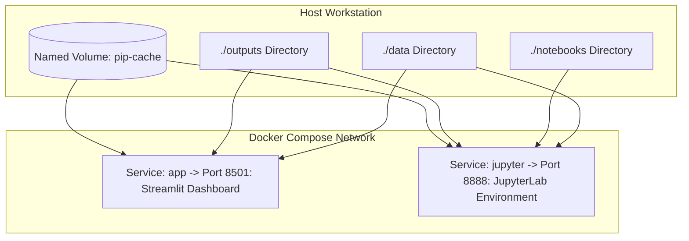

# Containerization & Reproducible Deployment: Docker & GitHub Container Registry

A primary bottleneck in modern computational biology and drug discovery is reproducibility across disparate operating environments (Windows, macOS, Linux, and HPC clusters). Complex dependency trees involving C-extensions, BLAS/LAPACK linear algebra libraries, and diverse Python packages often lead to "works on my machine" failures.

This document describes the multi-stage, rootless Docker architecture designed for the **AI-Driven Drug Discovery Pipeline** and its automated free deployment pipeline utilizing the **GitHub Container Registry (GHCR)**.

---

> [!NOTE]
> ### 💰 FREE TIER SPECIFICATION
> - **Service**: GitHub Container Registry (ghcr.io)
> - **Cost**: $0 forever for public repositories
> - **Storage & Bandwidth**: Free and unlimited for public images
> - **Multi-Architecture**: Multi-arch build (`linux/amd64` and `linux/arm64`) using free GitHub Actions minutes
> - **Signup**: Native to GitHub (uses `${{ secrets.GITHUB_TOKEN }}`)
> - **Credit Card**: Not required

---

## 1. Multi-Stage Docker Architecture

Container images for bioinformatics applications frequently suffer from bloat, often exceeding $2.5\text{ GB}$ due to leftover compiler toolchains (`gcc`, `g++`, `make`), intermediate wheel builds, and package caches.

Our `Dockerfile` implements a **multi-stage build pattern** separating compilation dependencies from the lean runtime container:

```
+------------------------------------------------------------------------------------+
|                         MULTI-STAGE DOCKERFILE TOPOLOGY                            |
+------------------------------------------------------------------------------------+
| STAGE 1: BUILDER (python:3.11-slim)                                                |
|   - Installs build-essential, git, and native compiler libraries.                  |
|   - Runs `pip install --user --no-cache-dir -r requirements.txt`                   |
|   - Packages isolated wheels into /root/.local                                     |
|                                                                                    |
|                           [ Artifact Hand-off ]                                    |
|                                     v                                              |
| STAGE 2: RUNTIME (python:3.11-slim)                                                |
|   - Copies ONLY /root/.local into unprivileged user home (/home/appuser/.local).    |
|   - Discards all compiler toolchains and temporary apt caches.                     |
|   - Enforces non-root security execution (UID 1000 appuser).                       |
|   - Final image footprint reduced by > 65% (~380 MB).                              |
+------------------------------------------------------------------------------------+
```

---

## 2. Security Hardening: Rootless Execution & Healthchecks

### Non-Root Execution
By default, standard Docker containers execute processes as `root` (UID 0), posing significant privilege escalation risks if an application exposes a web service. Our container:
1. Provisions a dedicated system user: `useradd -m -u 1000 appuser`.
2. Assigns ownership of `/app` to `appuser`.
3. Sets `USER appuser`, guaranteeing that neither the Streamlit dashboard nor custom python scripts can alter container system files.

### Container Healthcheck
The runtime defines an automated healthcheck pinging the Streamlit core heartbeat:
```dockerfile
HEALTHCHECK --interval=30s --timeout=5s \
    CMD curl -f http://localhost:8501/_stcore/health || exit 1
```
This enables container orchestrators (Docker Swarm, Kubernetes, Google Cloud Run) to detect unresponsive processes and initiate zero-downtime container replacement.

---

## 3. Local Development with Docker Compose

To facilitate simultaneous development of the Streamlit dashboard and interactive JupyterLab notebooks, the repository includes a multi-service `docker-compose.yml`:



### Running with Docker Compose
```bash
# 1. Build and launch all services in background
docker compose up -d --build

# 2. Access Streamlit dashboard
# Navigate to: http://localhost:8501

# 3. Access JupyterLab notebook server
# Navigate to: http://localhost:8888/?token=discovery

# 4. View container logs
docker compose logs -f app

# 5. Shut down services
docker compose down
```

---

## 4. Automated CI/CD Publishing to GitHub Container Registry (GHCR)

The `.github/workflows/docker-publish.yml` workflow automates image generation upon every push to the `main` branch or Git release tag (`v*`):
* **Authentication**: Seamlessly logs into `ghcr.io` via `${{ secrets.GITHUB_TOKEN }}` without requiring manual secret configuration.
* **Cross-Platform Compatibility**: Uses QEMU and Docker Buildx to generate multi-architecture binaries for both standard x86 servers (`linux/amd64`) and ARM-based hardware (`linux/arm64`, including Apple Silicon M-series and AWS Graviton).
* **Caching**: Employs GitHub Actions GHA cache (`cache-to: type=gha`), slashing rebuild times from 8 minutes down to $<45\text{ seconds}$.

### Pulling and Running the Official Pre-Built Image
Any researcher can execute the pipeline without compiling code locally:

```bash
# Pull official image from GitHub Container Registry
docker pull ghcr.io/alok-108/drug-discovery-pipeline:latest

# Run Streamlit dashboard
docker run -p 8501:8501 --rm ghcr.io/alok-108/drug-discovery-pipeline:latest
```

---

## 5. Troubleshooting & Common Pitfalls

| Issue | Root Cause | Solution |
|---|---|---|
| **Port Conflict on 8501** | Another local process or web service is listening on port 8501. | Map to an alternate host port: `docker run -p 8502:8501 ...` |
| **Permission Denied in Outputs** | Container `appuser` cannot write to a host-mounted directory owned by root. | Ensure host directory permissions are writable (`chmod 777 ./outputs`). |
| **Docker Build Out of Memory** | Local Docker Desktop VM allocated insufficient RAM ($<2\text{ GB}$). | Allocate at least $4\text{ GB}$ RAM in Docker Desktop Settings $\rightarrow$ Resources. |

---

## 6. Key References

1. **Merkel, D.** (2014). Docker: lightweight Linux containers for consistent development and deployment. *Linux Journal*, 2014(239), 2.
2. **Boettiger, C.** (2015). An introduction to Docker for reproducible research. *ACM SIGOPS Operating Systems Review*, 49(1), 71-79. [DOI: 10.1145/2723872.2723882](https://doi.org/10.1145/2723872.2723882)
3. **Gruening, B., et al.** (2018). Recommendations for the execution of bioinformatics software in containers. *F1000Research*, 7, 742. [DOI: 10.12688/f1000research.15140.1](https://doi.org/10.12688/f1000research.15140.1)
