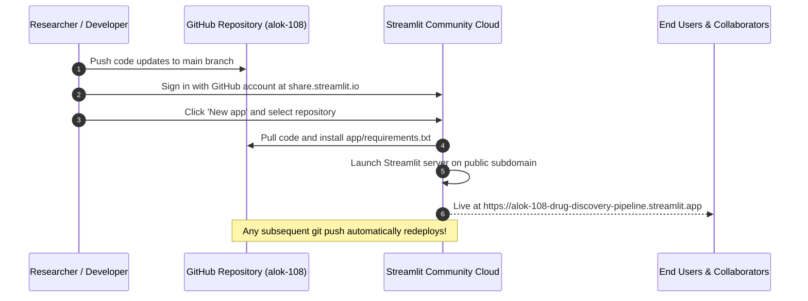

# Zero-Cost Dashboard Deployment: Streamlit Community Cloud & Cloud Alternatives

Visualizing multidimensional genomics, 3D biomolecular structures, and clinical trial matrices is crucial for multidisciplinary drug discovery teams. Rather than requiring teammates to install python packages, activate conda environments, and configure graphics drivers locally, the pipeline includes an interactive web application that can be deployed to the cloud for free with zero infrastructure management.

This guide provides step-by-step deployment instructions for **Streamlit Community Cloud** (primary zero-cost option), along with backup zero-cost hosting alternatives on **Hugging Face Spaces** and **Google Cloud Run**.

---

> [!NOTE]
> ### 💰 FREE TIER SPECIFICATION
> - **Service**: Streamlit Community Cloud (share.streamlit.io)
> - **Cost**: $0 forever (Free public apps)
> - **Hardware**: 1 GB RAM, shared vCPU, automatic HTTPS SSL certificates
> - **Continuous Deployment**: Automatically redeploys upon pushing Git commits to `main`
> - **Signup**: Native GitHub OAuth authentication
> - **Credit Card**: Not required

---

## 1. Streamlit Community Cloud: Step-by-Step Deployment (Primary Option)

Streamlit Community Cloud offers the fastest path to public hosting directly connected to your GitHub repository.



### Step-by-Step Deployment Walkthrough
1. **Fork or Push Repository to GitHub**:
   Ensure your repository is public and contains the latest code on the `main` branch.
2. **Access Streamlit Community Cloud**:
   Navigate to [https://share.streamlit.io](https://share.streamlit.io) in your web browser.
3. **Authenticate with GitHub**:
   Click **"Continue with GitHub"** and authorize the Streamlit application to read your public repositories (no credit card requested).
4. **Configure New App**:
   * Click the blue **"Create app"** or **"New app"** button.
   * **Repository**: `alok-108/drug-discovery-pipeline` (or your GitHub username).
   * **Branch**: `main`.
   * **Main file path**: `app/streamlit_app.py`.
   * **App URL (Custom Subdomain)**: `alok-108-drug-discovery-pipeline` (yields `https://alok-108-drug-discovery-pipeline.streamlit.app`).
5. **Deploy**:
   Click **"Deploy!"**. Streamlit will provision an isolated Linux container, install dependencies from `app/requirements.txt`, and launch the web server in under 2 minutes.
6. **Embed Badge in README**:
   Add the official Streamlit badge to your `README.md`:
   ```markdown
   [](https://alok-108-drug-discovery-pipeline.streamlit.app)
   ```

---

## 2. Backup Alternative A: Hugging Face Spaces (Zero Cost)

If Streamlit Community Cloud experiences maintenance or you desire community visibility within the open-source machine learning ecosystem, **Hugging Face Spaces** is an excellent free tier option:

* **Hardware**: Free CPU basic tier (2 vCPU, 16 GB RAM, 50 GB disk space).
* **Setup**:
  1. Create a free account at [https://huggingface.co](https://huggingface.co).
  2. Click **"New Space"** $\rightarrow$ Space SDK: **Streamlit**.
  3. Set Space visibility to **Public**.
  4. Clone the Hugging Face git remote and push the `app/` files or link directly to your GitHub repository using Hugging Face's automated GitHub sync action.

---

## 3. Backup Alternative B: Google Cloud Run Free Tier

For enterprise or institutional hosting that requires custom domains and fine-grained access control, **Google Cloud Run** provides a generous free tier:

* **Free Tier Quota**:
  * 2,000,000 requests per month free.
  * 360,000 vCPU-seconds and 180,000 GiB-seconds of memory per month.
  * Scales down to zero instances when idle, incurring $0 charges.
* **Deploy Command via gcloud**:
  ```bash
  # Build and submit image to Artifact Registry / Cloud Build
  gcloud builds submit --tag gcr.io/YOUR_PROJECT_ID/drug-discovery-pipeline

  # Deploy serverless container to Cloud Run
  gcloud run deploy drug-discovery-app \
      --image gcr.io/YOUR_PROJECT_ID/drug-discovery-pipeline \
      --platform managed \
      --region us-central1 \
      --allow-unauthenticated \
      --port 8501
  ```

---

## 4. Local Verification & Healthchecks

Before deploying to production, verify the application locally:

```bash
# Launch Streamlit locally in headless test mode
streamlit run app/streamlit_app.py --server.headless true

# In another terminal, verify the server heartbeat responds HTTP 200:
curl -f http://localhost:8501/_stcore/health
```

---

## 5. Troubleshooting & Resource Management

| Issue | Root Cause | Solution |
|---|---|---|
| **ModuleNotFoundError in Cloud** | `src/` not recognized on python path during cloud execution. | `app/utils/ot_api.py` and page scripts dynamically append `src/` to `sys.path`. |
| **App Exceeds 1GB RAM Limit** | Loading multi-gigabyte raw GWAS files directly into pandas memory. | Streamlit Cloud enforces a 1GB memory limit; upload downsampled or genome-wide significant summary tables ($<50\text{ MB}$). |
| **Sleep Mode Inactivity** | Streamlit Cloud puts applications to sleep after 7 consecutive days of zero traffic. | Click **"Yes, get this app back up!"** upon visiting; wake-up takes under 30 seconds. |

---

## 6. Key References

1. **Streamlit Inc.** (2024). *Streamlit Documentation: Deploying to Community Cloud*. [https://docs.streamlit.io/deploy/streamlit-community-cloud](https://docs.streamlit.io/deploy/streamlit-community-cloud)
2. **Google Cloud** (2024). *Cloud Run Pricing & Always Free Tier Specifications*. [https://cloud.google.com/run/pricing](https://cloud.google.com/run/pricing)
3. **Hugging Face** (2024). *Spaces Documentation: Streamlit Apps*. [https://huggingface.co/docs/hub/spaces-sdks-streamlit](https://huggingface.co/docs/hub/spaces-sdks-streamlit)
