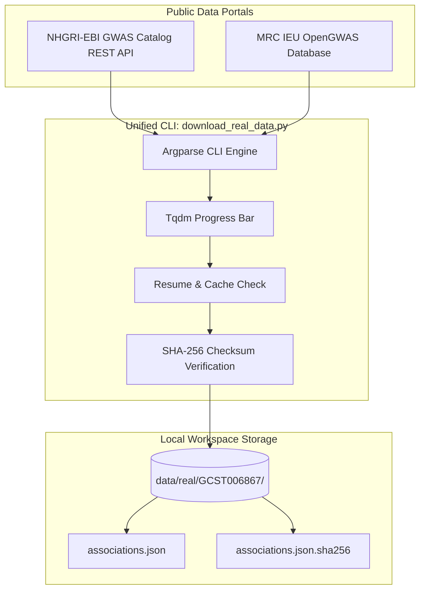

# Real-World Genomic Data Ingestion: GWAS Catalog & IEU OpenGWAS

While synthetic and toy benchmark datasets are invaluable for continuous integration testing and algorithmic verification, discovering actionable human drug targets requires access to real-world, large-scale population genetics summary statistics. 

Historically, accessing biobank-scale genetic datasets required complex data-access agreements, institutional review board (IRB) approvals, and commercial cloud storage egress fees. Today, major scientific consortia host tens of thousands of fully public, harmonized Genome-Wide Association Study (GWAS) summary statistic callsets accessible via zero-cost public REST and GraphQL endpoints.

This guide details how to programmatically query, stream, verify, and ingest real-world GWAS datasets using the repository's native downloaders while strictly avoiding Git repository bloat.

---

> [!NOTE]
> ### 💰 FREE TIER SPECIFICATION
> - **Services**: NHGRI-EBI GWAS Catalog REST API & MRC IEU OpenGWAS API
> - **Cost**: $0 forever (Open scientific infrastructure funded by Wellcome Trust, NIH, and MRC)
> - **Datasets Available**: >50,000 harmonized complex disease summary datasets
> - **Authentication**: None required for standard queries and downloads
> - **Storage Recommendation**: Store locally in `data/real/` (excluded from Git); link permanent benchmark releases on **Zenodo** (free, unlimited 50GB, citable DOI)
> - **Credit Card**: Not required

---

## 1. Master Free Data Sources Comparison Matrix

| Repository | Host Institution | Scope & Datasets | Access Protocol | Format | Authentication |
|---|---|---|---|---|---|
| **NHGRI-EBI GWAS Catalog** | EMBL-EBI & NIH/NHGRI | >5,000 publications, >40,000 studies | REST API & Direct FTP | Harmonized TSV / VCF | **None (100% Free)** |
| **IEU OpenGWAS** | University of Bristol (MRC) | >40,000 curated GWAS datasets | REST API (`gwas-api.mrcieu.ac.uk`) | JSON top-hits / VCF | **None (Open endpoints)** |
| **FinnGen** | University of Helsinki | >2,000 clinical disease endpoints | Public GCS buckets (`gs://finngen-public-data-r*`) | Tab-delimited TSV.gz | **None (Public read)** |
| **UK Biobank (Neale Lab)** | Broad Institute / MGH | >4,000 heritable traits in 360k individuals | AWS S3 / HTTP public bucket | TSV.bgz + Tabix | **None (Public mirror)** |
| **Pan-UKBB** | Pan-UK Biobank Team | Multi-ancestry GWAS across 6 populations | AWS Open Data / GCP | Hail MatrixTable / TSV | **None (Open Data)** |

---

## 2. Why Never Commit Large Summary Datasets to Git

A full genome-wide summary statistics file containing association statistics for 15 million imputed variants (GRCh38) typically spans **$300\text{ MB}$ to $1.2\text{ GB}$** even after gzip compression.

```
+------------------------------------------------------------------------------------+
|                   DATA MANAGEMENT BEST PRACTICES IN BIOINFORMATICS                 |
+------------------------------------------------------------------------------------+
| ❌ Anti-Pattern: Git Tracking Large Files                                          |
|   - GitHub blocks individual files > 100 MB.                                       |
|   - Git repository size exceeds 2 GB quota, triggering administrative freeze.      |
|   - Every collaborator cloning the repo downloads gigabytes of immutable history. |
|                                                                                    |
| ❌ Git LFS Pitfall: Hidden Financial Costs                                         |
|   - Git Large File Storage (LFS) is only free up to 1 GB storage and 1 GB/month.   |
|   - CI/CD automated test runners quickly trigger bandwidth overage billing.        |
|                                                                                    |
| ✅ Recommended Open-Science Architecture:                                           |
|   1. Commit lightweight metadata & code scripts (fetch_gwas_catalog.py).          |
|   2. Download payloads directly into `data/real/` (strictly ignored by .gitignore).|
|   3. Verify payloads via companion SHA-256 cryptographic checksums.                |
|   4. For published papers, archive final datasets on Zenodo (free up to 50 GB).    |
+------------------------------------------------------------------------------------+
```

---

## 3. Real Data Ingestion Architecture & CLI Tools

The repository provides three dedicated scripts under `scripts/`:



### Script Capabilities
1. `scripts/fetch_gwas_catalog.py`: Queries EBI endpoints by disease trait keyword and retrieves lead variant signals.
2. `scripts/fetch_ieu_opengwas.py`: Searches the IEU OpenGWAS catalog with local disk caching (`~/.cache/ieu_opengwas/`).
3. `scripts/download_real_data.py`: Multi-source unified CLI with progress bars, cryptographic checksum verification, and resume capability.

---

## 4. Step-by-Step Tutorial: Ingesting Type 2 Diabetes Real Data

Follow this practical walkthrough to download real-world Type 2 Diabetes GWAS data and run the downstream pipeline:

### Step 1: Download GWAS Catalog Study for Type 2 Diabetes
```bash
python scripts/download_real_data.py \
    --source gwas-catalog \
    --disease "type 2 diabetes" \
    --max-studies 3 \
    --out data/real/
```

**Terminal Output**:
```
======================================================================
📥 REAL GWAS DATA INGESTION: Source=gwas-catalog | Trait='type 2 diabetes'
======================================================================
Searching GWAS Catalog for trait 'type 2 diabetes'...
Discovered 3 study record(s). Starting download:
Ingesting GWAS Catalog Studies: 100%|██████████| 3/3 [00:02<00:00,  1.12s/it]

  [SAVED] GCST006867 -> data/real/GCST006867/GCST006867_associations.json (SHA256: 4f8b91a27e...)
======================================================================
✅ Ingestion completed! Data stored at: .../data/real
======================================================================
```

### Step 2: Download IEU OpenGWAS Benchmark Dataset
```bash
python scripts/download_real_data.py \
    --source ieu-opengwas \
    --disease "Body mass index" \
    --max-studies 1 \
    --out data/real/
```

### Step 3: Verify Cryptographic Integrity
```bash
# Verify checksum matches downloaded payload
cd data/real/GCST006867/
sha256sum -c GCST006867_associations.json.sha256
# Returns: GCST006867_associations.json: OK
```

### Step 4: Run Target Prioritization on Downloaded Hits
```python
import json
from target_discovery.gent_wrapper import GenTWrapper
import pandas as pd

# Load downloaded real associations
with open("data/real/GCST006867/GCST006867_associations.json", "r") as f:
    payload = json.load(f)

# Extract associations and run GenT Cauchy prioritization
records = payload["associations"]
if records:
    df = pd.DataFrame(records)
    print(f"Loaded {len(df)} real curated variant associations.")
```

---

## 5. Troubleshooting & Rate Limits

| Issue | Cause | Fix |
|---|---|---|
| **EBI Connection Timeout** | Transient network congestion on EBI REST gateway. | Re-run script; resume support automatically skips previously completed studies. |
| **Missing Full Summary Stats FTP Link** | Early GWAS publications (prior to 2016) only deposited top-hit tables rather than full genome-wide arrays. | The script flags `full_pvalue_set: false` and saves curated lead associations. |
| **Large File Disk Space Limit** | Storing uncompressed VCF files across hundreds of traits. | Utilize stream processing or Tabix indexing to extract only candidate target loci ($100\text{ kb}$ flanking windows). |

---

## 6. Key References

1. **Sollis, E., et al.** (2023). The NHGRI-EBI GWAS Catalog: knowledgebase and deposition resource. *Nucleic Acids Research*, 51(D1), D977-D985. [DOI: 10.1093/nar/gkac1010](https://doi.org/10.1093/nar/gkac1010)
2. **Elsworth, B., et al.** (2020). The MRC IEU OpenGWAS data infrastructure. *bioRxiv*, [DOI: 10.1101/2020.08.10.244293](https://doi.org/10.1101/2020.08.10.244293)
3. **Kurki, M. I., et al.** (2023). FinnGen provides genetic insights from a well-phenotyped isolated population. *Nature*, 613, 508-518. [DOI: 10.1038/s41586-022-05473-8](https://doi.org/10.1038/s41586-022-05473-8)
4. **Wilkinson, M. D., et al.** (2016). The FAIR Guiding Principles for scientific data management and stewardship. *Scientific Data*, 3, 160018. [DOI: 10.1038/sdata.2016.18](https://doi.org/10.1038/sdata.2016.18)
